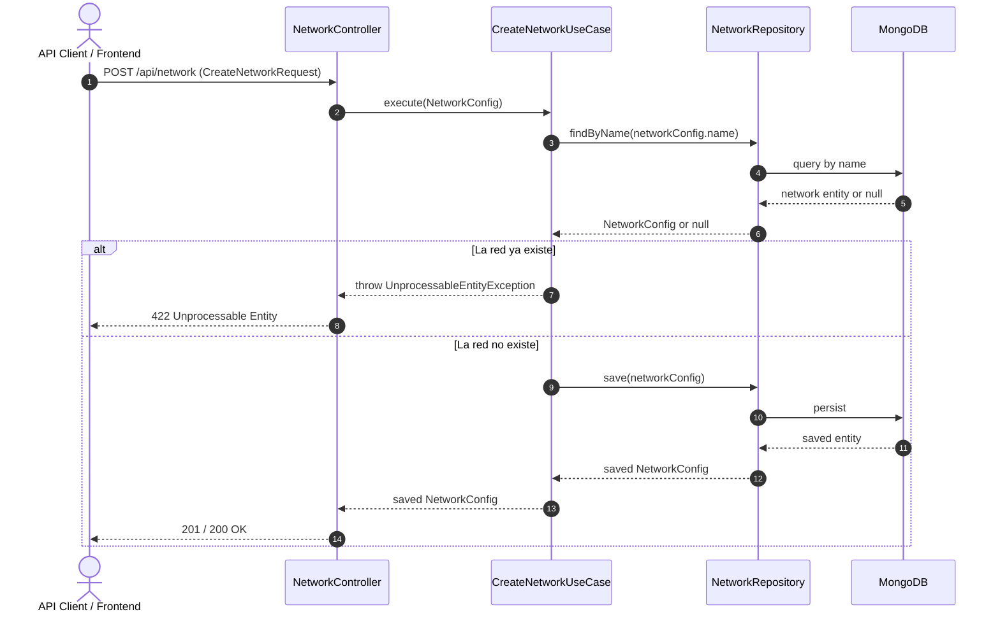

# Caso de Uso: `CreateNetworkUseCase`

- **Clase:** `com.biopatternsg.application.usecase.CreateNetworkUseCase`
- **Puerto de Entrada:** `com.biopatternsg.domain.port.in.CreateNetwork`
- **Puerto de Salida:** `com.biopatternsg.domain.port.out.repositories.NetworkRepository`
- **Controlador Invocador:** `com.biopatternsg.infrastructure.adapters.in.restcontrollers.NetworkController`

---

## 1. Propósito
Permite registrar una nueva red biológica (`NetworkConfig`) en el sistema, asegurando que no existan colisiones de nombres para mantener la unicidad de las redes.

---

## 2. Flujo de Ejecución

1. Recibe un objeto de dominio `NetworkConfig` desde el controlador REST.
2. Consulta `NetworkRepository.findByName(name)` para verificar si ya existe una red con el mismo nombre.
3. Si la red ya existe, lanza `UnprocessableEntityException("The network already exists")`.
4. Si no existe, persiste la entidad invocando `NetworkRepository.save(networkConfig)` y retorna el modelo creado.

---

## 3. Diagrama de Flujo (Mermaid)

