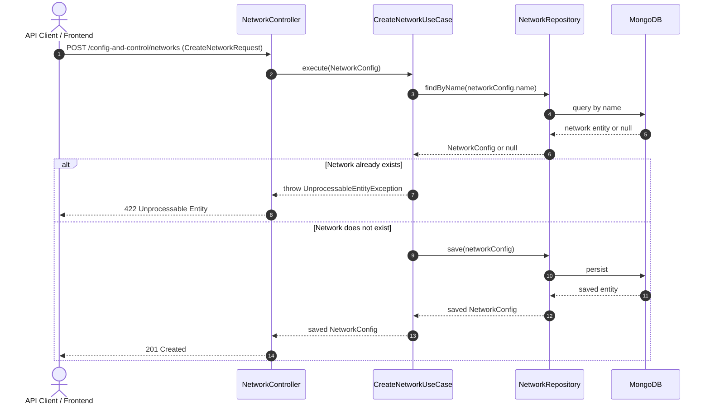

# Use Case: `CreateNetworkUseCase`

- **Class:** `com.biopatternsg.application.usecase.CreateNetworkUseCase`
- **Inbound Port:** `com.biopatternsg.domain.port.in.CreateNetwork`
- **Outbound Port:** `com.biopatternsg.domain.port.out.repositories.NetworkRepository`
- **Invoking Controller:** `com.biopatternsg.infrastructure.adapters.in.restcontrollers.NetworkController`

---

## 1. Purpose
Registers a new biological network (`NetworkConfig`) in the system, ensuring no name collisions occur so network names remain unique per user.

---

## 2. Execution Flow

1. Receives a `NetworkConfig` domain object from the REST controller.
2. Queries `NetworkRepository.findByName(name)` to verify whether a network with the same name already exists.
3. If the network already exists, throws `UnprocessableEntityException("The network already exists")`.
4. Otherwise, persists the entity by calling `NetworkRepository.save(networkConfig)` and returns the created domain model.

---

## 3. Sequence Diagram (Mermaid)

---

## 4. Error Cases

- **Duplicate Network Name:** Throws `UnprocessableEntityException("The network already exists")` when a network with the same name already exists for the user.
