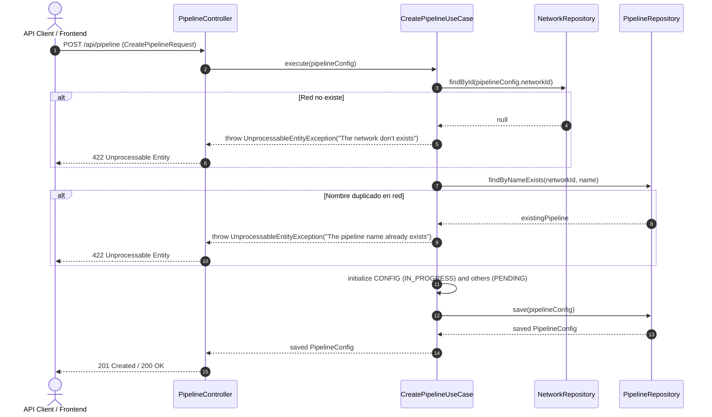

# Caso de Uso: `CreatePipelineUseCase`

- **Clase:** `com.biopatternsg.application.usecase.CreatePipelineUseCase`
- **Puerto de Entrada:** `com.biopatternsg.domain.port.in.CreatePipeline`
- **Puertos de Salida:**
  - `com.biopatternsg.domain.port.out.repositories.NetworkRepository`
  - `com.biopatternsg.domain.port.out.repositories.PipelineRepository`
- **Controlador Invocador:** `com.biopatternsg.infrastructure.adapters.in.restcontrollers.PipelineController`

---

## 1. Propósito
Crea una nueva configuración de pipeline (`PipelineConfig`) asociada a una red biológica específica, inicializando los pasos del pipeline (`PipelineSteps`) en sus estados correspondientes (`CONFIG` en `IN_PROGRESS` y el resto en `PENDING`).

---

## 2. Flujo de Ejecución

1. Recibe el objeto `PipelineConfig` con `networkId`, `name`, `description`, etc.
2. Valida que la red padre exista llamando a `NetworkRepository.findById(pipelineConfig.networkId)`. Si no existe, lanza `UnprocessableEntityException("The network don't exists")`.
3. Valida que no exista un pipeline con el mismo nombre dentro de esa misma red (`PipelineRepository.findByNameExists(networkId, name)`). Si ya existe, lanza `UnprocessableEntityException("The pipeline name already exists")`.
4. Inicializa todos los pasos definidos en `PipelineSteps`:
   - `PipelineSteps.CONFIG` -> `Status.IN_PROGRESS`.
   - Demás pasos -> `Status.PENDING`.
5. Establece el paso activo inicial en `PipelineSteps.CONFIG`.
6. Guarda la configuración en base de datos mediante `PipelineRepository.save(...)` y retorna el objeto creado.

---

## 3. Diagrama de Flujo (Mermaid)

