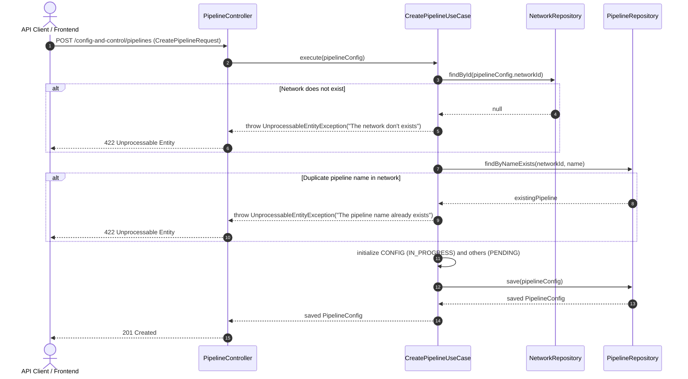

# Use Case: `CreatePipelineUseCase`

- **Class:** `com.biopatternsg.application.usecase.CreatePipelineUseCase`
- **Inbound Port:** `com.biopatternsg.domain.port.in.CreatePipeline`
- **Outbound Ports:**
  - `com.biopatternsg.domain.port.out.repositories.NetworkRepository`
  - `com.biopatternsg.domain.port.out.repositories.PipelineRepository`
- **Invoking Controller:** `com.biopatternsg.infrastructure.adapters.in.restcontrollers.PipelineController`

---

## 1. Purpose
Creates a new pipeline configuration (`PipelineConfig`) linked to a specific biological network, initializing all pipeline steps (`PipelineSteps`) to their starting states (`CONFIG` set to `IN_PROGRESS` and all remaining steps set to `PENDING`).

---

## 2. Execution Flow

1. Receives a `PipelineConfig` domain object containing `networkId`, `name`, `description`, etc.
2. Validates that the parent network exists via `NetworkRepository.findById(pipelineConfig.networkId)`. If not found, throws `UnprocessableEntityException("The network don't exists")`.
3. Validates that no pipeline with the same name already exists within that network (`PipelineRepository.findByNameExists(networkId, name)`). If a match is found, throws `UnprocessableEntityException("The pipeline name already exists")`.
4. Initializes all steps defined in `PipelineSteps`:
   - `PipelineSteps.CONFIG` -> `Status.IN_PROGRESS`.
   - All other steps -> `Status.PENDING`.
5. Sets the active step to `PipelineSteps.CONFIG`.
6. Persists the configuration via `PipelineRepository.save(...)` and returns the created domain object.

---

## 3. Sequence Diagram (Mermaid)

---

## 4. Error Cases

- **Parent Network Not Found:** Throws `UnprocessableEntityException("The network don't exists")`.
- **Duplicate Pipeline Name in Network:** Throws `UnprocessableEntityException("The pipeline name already exists")`.
