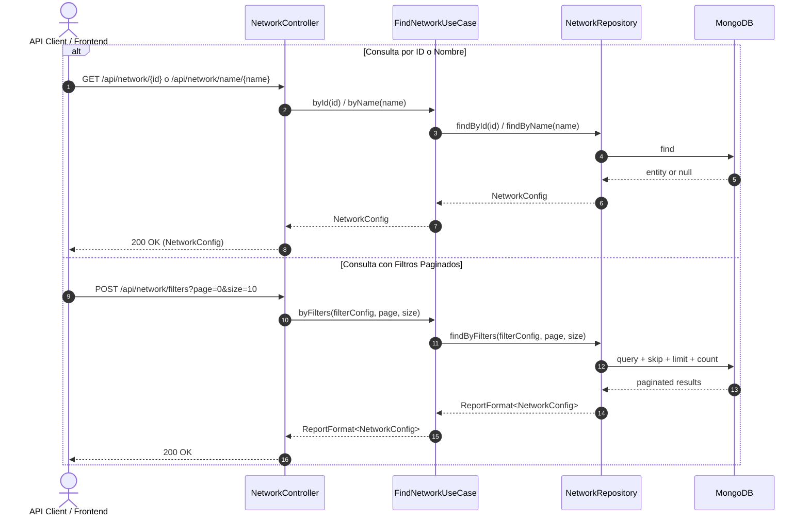

# Caso de Uso: `FindNetworkUseCase`

- **Clase:** `com.biopatternsg.application.usecase.FindNetworkUseCase`
- **Puerto de Entrada:** `com.biopatternsg.domain.port.in.FindNetwork`
- **Puerto de Salida:** `com.biopatternsg.domain.port.out.repositories.NetworkRepository`
- **Controlador Invocador:** `com.biopatternsg.infrastructure.adapters.in.restcontrollers.NetworkController`

---

## 1. Propósito
Provee métodos de consulta de redes biológicas: búsqueda por identificador único (`id`), búsqueda exacta por nombre (`name`) y búsqueda paginada aplicando filtros dinámicos (`byFilters`).

---

## 2. Métodos y Flujo de Ejecución

1. **`byId(String id)`:** Delega en `NetworkRepository.findById(id)`.
2. **`byName(String name)`:** Delega en `NetworkRepository.findByName(name)`.
3. **`byFilters(NetworkConfig findNetwork, int page, int size)`:** Consulta `NetworkRepository.findByFilters(...)` aplicando paginación y retornando un `ReportFormat<NetworkConfig>` (lista de resultados, total de páginas y conteo).

---

## 3. Diagrama de Flujo (Mermaid)

