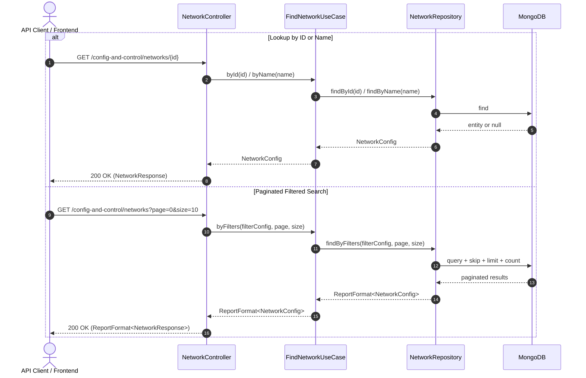

# Use Case: `FindNetworkUseCase`

- **Class:** `com.biopatternsg.application.usecase.FindNetworkUseCase`
- **Inbound Port:** `com.biopatternsg.domain.port.in.FindNetwork`
- **Outbound Port:** `com.biopatternsg.domain.port.out.repositories.NetworkRepository`
- **Invoking Controller:** `com.biopatternsg.infrastructure.adapters.in.restcontrollers.NetworkController`

---

## 1. Purpose
Provides query operations for biological networks: lookup by unique identifier (`byId`), exact lookup by name (`byName`), and paginated search using dynamic filters (`byFilters`).

---

## 2. Methods & Execution Flow

1. **`byId(String id)`:** Delegates to `NetworkRepository.findById(id)`.
2. **`byName(String name)`:** Delegates to `NetworkRepository.findByName(name)`.
3. **`byFilters(NetworkConfig findNetwork, int page, int size)`:** Queries `NetworkRepository.findByFilters(...)` with pagination and returns a `ReportFormat<NetworkConfig>` envelope containing the matching items and total count.

---

## 3. Sequence Diagram (Mermaid)

