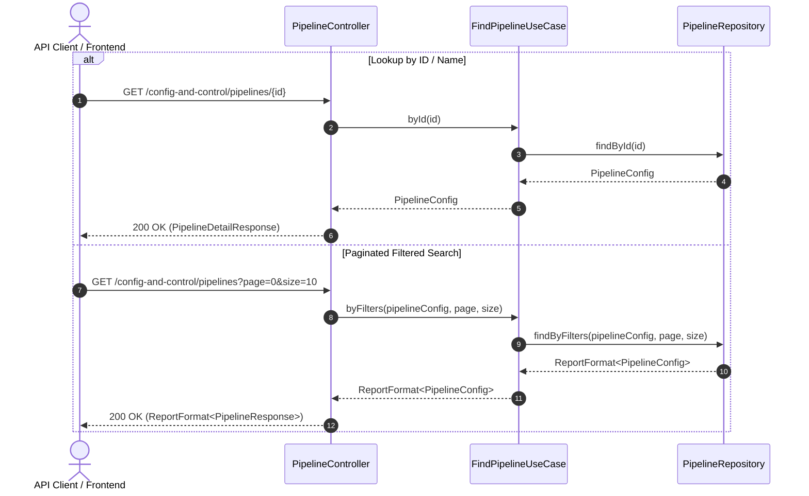

# Use Case: `FindPipelineUseCase`

- **Class:** `com.biopatternsg.application.usecase.FindPipelineUseCase`
- **Inbound Port:** `com.biopatternsg.domain.port.in.FindPipeline`
- **Outbound Port:** `com.biopatternsg.domain.port.out.repositories.PipelineRepository`
- **Invoking Controller:** `com.biopatternsg.infrastructure.adapters.in.restcontrollers.PipelineController`

---

## 1. Purpose
Provides query and read operations for pipeline configurations: lookup by unique identifier (`byId`), exact lookup by name (`byName`), and paginated filtered search (`byFilters`).

---

## 2. Methods & Execution Flow

1. **`byId(String id)`:** Invokes `PipelineRepository.findById(id)` and returns the requested pipeline configuration.
2. **`byName(String name)`:** Invokes `PipelineRepository.findByName(name)` to find a pipeline configuration by exact name.
3. **`byFilters(PipelineConfig findPipeline, int page, int size)`:** Queries `PipelineRepository.findByFilters(...)` to filter pipelines by network, name, or description, returning a `ReportFormat<PipelineConfig>` containing the result page and total count.

---

## 3. Sequence Diagram (Mermaid)

