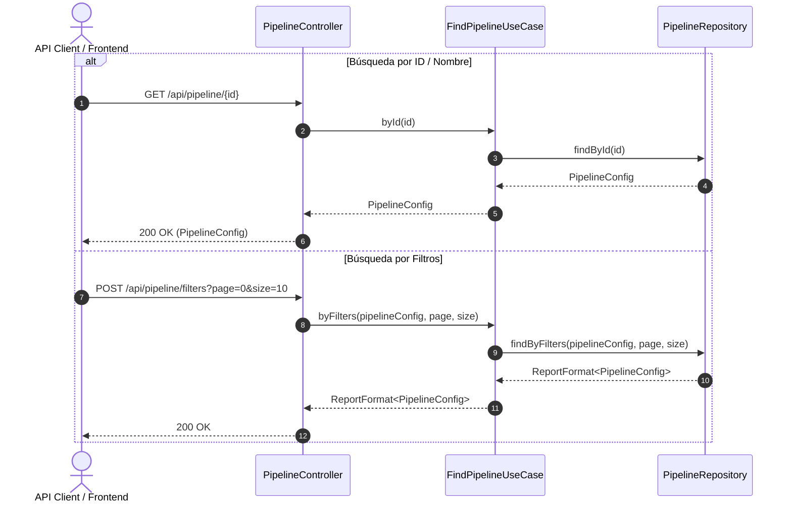

# Caso de Uso: `FindPipelineUseCase`

- **Clase:** `com.biopatternsg.application.usecase.FindPipelineUseCase`
- **Puerto de Entrada:** `com.biopatternsg.domain.port.in.FindPipeline`
- **Puerto de Salida:** `com.biopatternsg.domain.port.out.repositories.PipelineRepository`
- **Controlador Invocador:** `com.biopatternsg.infrastructure.adapters.in.restcontrollers.PipelineController`

---

## 1. Propósito
Ofrece las operaciones de consulta y lectura de configuraciones de pipelines: búsqueda por identificador (`byId`), por nombre (`byName`) y filtrado avanzado con paginación (`byFilters`).

---

## 2. Métodos y Flujo de Ejecución

1. **`byId(String id)`:** Invoca `PipelineRepository.findById(id)` y retorna la configuración del pipeline solicitada.
2. **`byName(String name)`:** Invoca `PipelineRepository.findByName(name)` para encontrar una configuración por nombre exacto.
3. **`byFilters(PipelineConfig findPipeline, int page, int size)`:** Consulta `PipelineRepository.findByFilters(...)` permitiendo filtrar por red, estado de pasos o usuario, devolviendo un `ReportFormat<PipelineConfig>` con la página de resultados y metadatos de paginación.

---

## 3. Diagrama de Flujo (Mermaid)

