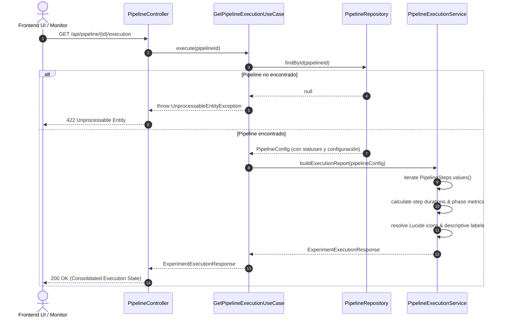

# Caso de Uso: `GetPipelineExecutionUseCase`

- **Clase:** `com.biopatternsg.application.usecase.GetPipelineExecutionUseCase`
- **Puerto de Entrada:** `com.biopatternsg.domain.port.in.GetPipelineExecution`
- **Puerto de Salida:** `com.biopatternsg.domain.port.out.repositories.PipelineRepository`
- **Servicios de Aplicación Inyectados:** `com.biopatternsg.application.services.PipelineExecutionService`
- **Controlador Invocador:** `com.biopatternsg.infrastructure.adapters.in.restcontrollers.PipelineController`

---

## 1. Propósito
Actúa como un **orquestador liviano** (Principio II de la Constitución) que coordina la consulta del estado de ejecución de un experimento/pipeline. Valida la existencia del pipeline a través del repositorio de persistencia y delega la agregación de métricas, cronología, duraciones y mapeo de iconos/descripciones UI al servicio especializado `PipelineExecutionService`.

---

## 2. Flujo de Ejecución

1. Recupera la entidad `PipelineConfig` mediante `PipelineRepository.findById(pipelineId)`.
2. Si no existe, lanza `UnprocessableEntityException("The pipeline don't exists")`.
3. Delega la construcción del informe métrico y cronológico a `PipelineExecutionService.buildExecutionReport(pipelineConfig)`.
4. Retorna el objeto `ExperimentExecutionResponse` construido por el servicio.

---

## 3. Diagrama de Flujo (Mermaid)

---

## 4. Casos de Error

- **Pipeline Inexistente:** Se lanza `UnprocessableEntityException` con mensaje `"The pipeline don't exists"` si el repositorio retorna `null`.
