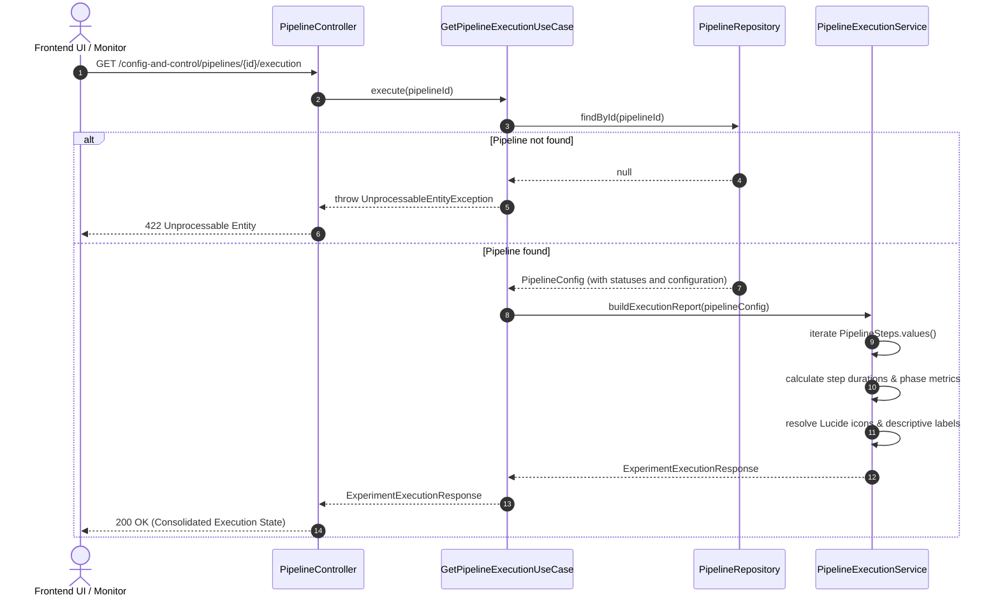

# Use Case: `GetPipelineExecutionUseCase`

- **Class:** `com.biopatternsg.application.usecase.GetPipelineExecutionUseCase`
- **Inbound Port:** `com.biopatternsg.domain.port.in.GetPipelineExecution`
- **Outbound Port:** `com.biopatternsg.domain.port.out.repositories.PipelineRepository`
- **Injected Application Services:** `com.biopatternsg.application.services.PipelineExecutionService`
- **Invoking Controller:** `com.biopatternsg.infrastructure.adapters.in.restcontrollers.PipelineController`

---

## 1. Purpose
Acts as a **lightweight orchestrator** (Constitution Principle II) that coordinates querying the execution progress of an experiment/pipeline. It validates pipeline existence through the persistence repository and delegates metric aggregation, timeline calculation, step durations, and UI icon/description mapping to `PipelineExecutionService`.

---

## 2. Execution Flow

1. Retrieves the `PipelineConfig` entity via `PipelineRepository.findById(pipelineId)`.
2. If not found, throws `UnprocessableEntityException("The pipeline don't exists")`.
3. Delegates construction of the metric and timeline execution report to `PipelineExecutionService.buildExecutionReport(pipelineConfig)`.
4. Returns the consolidated `ExperimentExecutionResponse` built by the service.

---

## 3. Sequence Diagram (Mermaid)

---

## 4. Error Cases

- **Non-existent Pipeline:** Throws `UnprocessableEntityException` with message `"The pipeline don't exists"` if the repository returns `null`.
