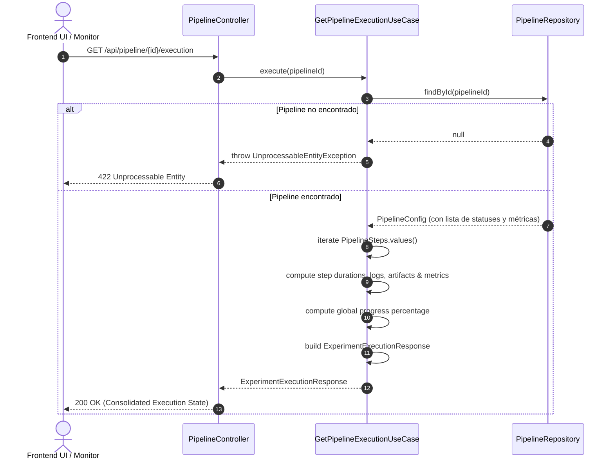

# Caso de Uso: `GetPipelineExecutionUseCase`

- **Clase:** `com.biopatternsg.application.usecase.GetPipelineExecutionUseCase`
- **Puerto de Entrada:** `com.biopatternsg.domain.port.in.GetPipelineExecution`
- **Puerto de Salida:** `com.biopatternsg.domain.port.out.repositories.PipelineRepository`
- **Controlador Invocador:** `com.biopatternsg.infrastructure.adapters.in.restcontrollers.PipelineController`

---

## 1. Propósito
Reconstruye una vista consolidada y detallada de la ejecución de un experimento/pipeline (`ExperimentExecutionResponse`). Calcula métricas de progreso global, tiempos de ejecución por paso, duraciones totales, estado de cada fase, artefactos procesados y métricas detalladas para la visualización en la interfaz de usuario.

---

## 2. Flujo de Ejecución

1. Recupera la entidad `PipelineConfig` mediante `PipelineRepository.findById(pipelineId)`.
2. Si no existe, lanza `UnprocessableEntityException("The pipeline don't exists")`.
3. Itera sobre todos los pasos ordenados de `PipelineSteps`:
   - Agrupa los estados históricos registrados para cada paso.
   - Determina el estado actual del paso (`PENDING`, `IN_PROGRESS`, `COMPLETED`, `FAILED`).
   - Calcula marcas de tiempo (inicio, finalización, duración transcurrida en segundos).
   - Extrae métricas específicas del paso (ej. número de factores de transcripción alineados, objetos expertos, búsquedas completadas).
4. Calcula el progreso porcentual global del pipeline.
5. Construye y retorna el DTO compuesto `ExperimentExecutionResponse`.

---

## 3. Diagrama de Flujo (Mermaid)

