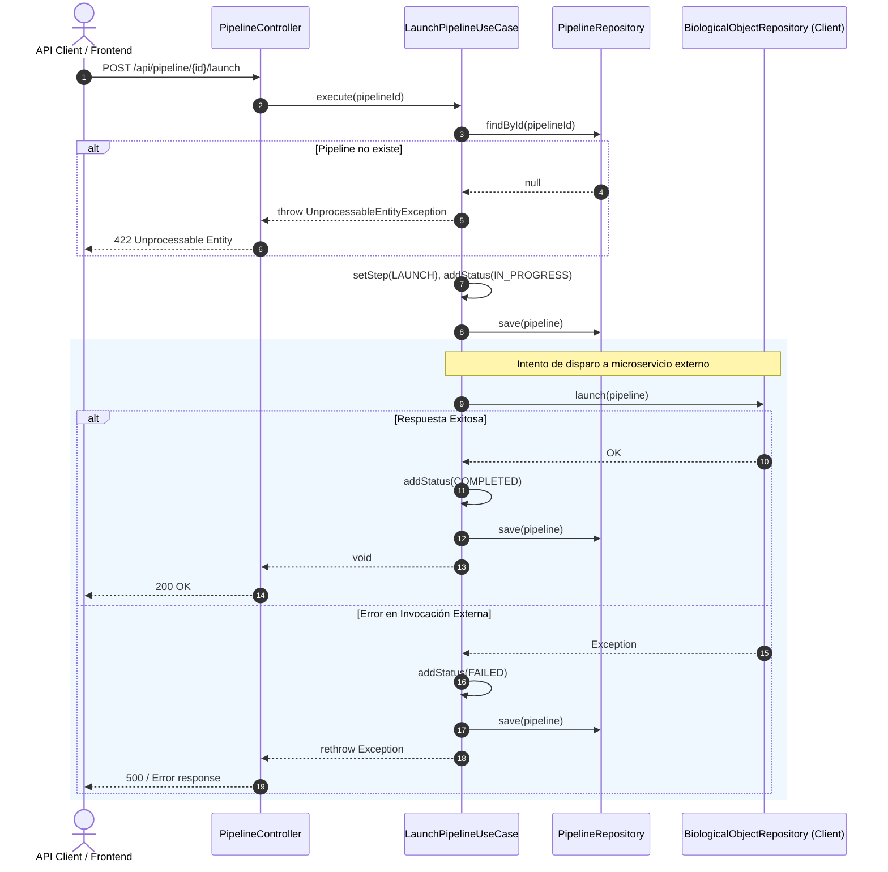

# Caso de Uso: `LaunchPipelineUseCase`

- **Clase:** `com.biopatternsg.application.usecase.LaunchPipelineUseCase`
- **Puerto de Entrada:** `com.biopatternsg.domain.port.in.LaunchPipeline`
- **Puertos de Salida:**
  - `com.biopatternsg.domain.port.out.repositories.BiologicalObjectRepository`
  - `com.biopatternsg.domain.port.out.repositories.PipelineRepository`
- **Controlador Invocador:** `com.biopatternsg.infrastructure.adapters.in.restcontrollers.PipelineController`

---

## 1. Propósito
Inicia la ejecución formal de un pipeline previamente configurado. Actualiza el estado del pipeline a `LAUNCH` / `IN_PROGRESS`, invoca al microservicio de objetos biológicos (`biological-objects`) para comenzar la recolección/procesamiento de datos y registra el resultado (`COMPLETED` o `FAILED`).

---

## 2. Flujo de Ejecución

1. Busca el pipeline por ID (`PipelineRepository.findById(pipelineId)`). Si no existe, lanza `UnprocessableEntityException("The pipeline don't exist")`.
2. Actualiza el paso activo a `PipelineSteps.LAUNCH` con estado `Status.IN_PROGRESS` y persiste el cambio.
3. Intenta disparar el proceso en el cliente externo a través de `BiologicalObjectRepository.launch(pipeline)`:
   - **Éxito:** Agrega el estado `Status.COMPLETED` al pipeline y lo guarda.
   - **Fallo (Excepción):** Captura el error, asigna el estado `Status.FAILED`, guarda el estado fallido en la base de datos y relanza la excepción.

---

## 3. Diagrama de Flujo (Mermaid)

