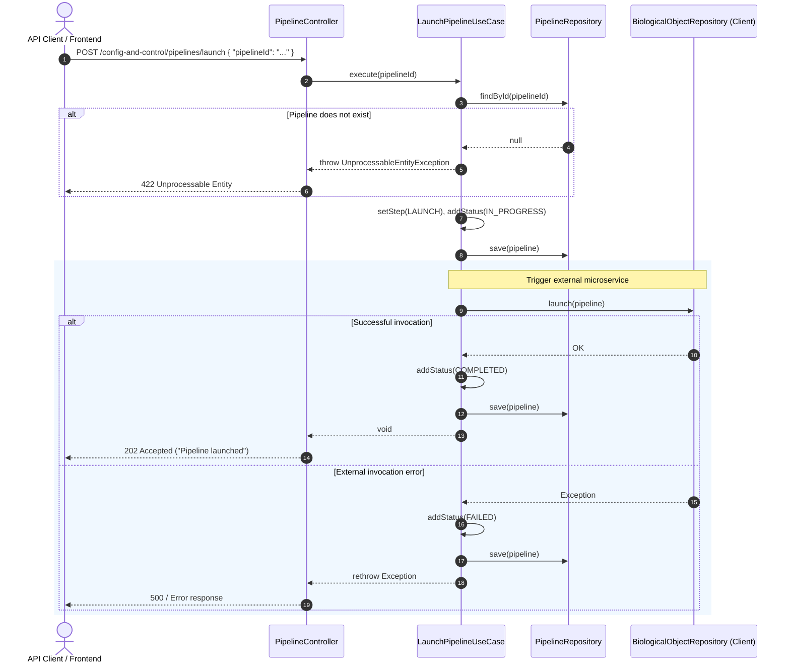

# Use Case: `LaunchPipelineUseCase`

- **Class:** `com.biopatternsg.application.usecase.LaunchPipelineUseCase`
- **Inbound Port:** `com.biopatternsg.domain.port.in.LaunchPipeline`
- **Outbound Ports:**
  - `com.biopatternsg.domain.port.out.repositories.BiologicalObjectRepository`
  - `com.biopatternsg.domain.port.out.repositories.PipelineRepository`
- **Invoking Controller:** `com.biopatternsg.infrastructure.adapters.in.restcontrollers.PipelineController`

---

## 1. Purpose
Initiates the formal execution of a previously configured pipeline. It transitions the pipeline step state to `LAUNCH` / `IN_PROGRESS`, invokes the external `biological-objects` microservice to begin data collection and processing, and records the outcome (`COMPLETED` or `FAILED`).

---

## 2. Execution Flow

1. Looks up the pipeline by ID (`PipelineRepository.findById(pipelineId)`). If not found, throws `UnprocessableEntityException("The pipeline don't exist")`.
2. Updates the active step to `PipelineSteps.LAUNCH` with status `Status.IN_PROGRESS` and persists the state.
3. Triggers execution in the external service via `BiologicalObjectRepository.launch(pipeline)`:
   - **Success:** Appends status `Status.COMPLETED` to the pipeline and saves it.
   - **Failure (Exception):** Catches the exception, appends status `Status.FAILED`, persists the failed state in the database, and rethrows the exception.

---

## 3. Sequence Diagram (Mermaid)

---

## 4. Error Catalog & Domain Exceptions

| Error Scenario | Layer | Handling & Response |
|---|---|---|
| Pipeline not found in DB | Domain | Throws `UnprocessableEntityException("The pipeline don't exist")`, mapped to `422 Unprocessable Entity`. |
| Error calling `biological-objects` microservice | Infrastructure (REST Client) | Caught, marks pipeline as `FAILED`, persists state, and rethrows returning `500 Internal Server Error`. |
