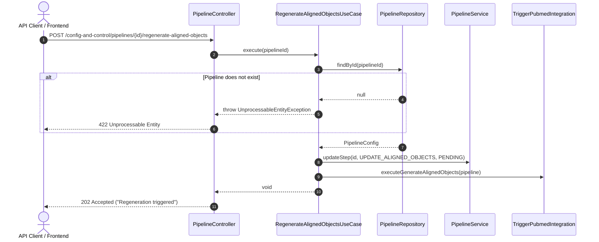

# Use Case: `RegenerateAlignedObjectsUseCase`

- **Class:** `com.biopatternsg.application.usecase.RegenerateAlignedObjectsUseCase`
- **Inbound Port:** `com.biopatternsg.domain.port.in.RegenerateAlignedObjects`
- **Outbound Ports:**
  - `com.biopatternsg.domain.port.out.repositories.PipelineRepository`
  - `com.biopatternsg.domain.port.out.TriggerPubmedIntegration`
- **Application / Domain Services Involved:**
  - `PipelineService`
- **Invoking Controller:** `com.biopatternsg.infrastructure.adapters.in.restcontrollers.PipelineController`

---

## 1. Purpose
Resets the manual expert object alignment confirmation step (`UPDATE_ALIGNED_OBJECTS`) to `PENDING` and re-triggers aligned object generation in the external `pubmed-integration` microservice.

---

## 2. Execution Flow

1. Receives `pipelineId`.
2. Looks up the pipeline via `PipelineRepository.findById(pipelineId)`. If not found, throws `UnprocessableEntityException("The pipeline don't exists")`.
3. Resets the `PipelineSteps.UPDATE_ALIGNED_OBJECTS` step to `Status.PENDING` via `PipelineService.updateStep(...)`.
4. Triggers aligned objects generation by calling `TriggerPubmedIntegration.executeGenerateAlignedObjects(pipeline)`.

---

## 3. Sequence Diagram (Mermaid)

---

## 4. Error Cases

- **Non-existent Pipeline:** Throws `UnprocessableEntityException("The pipeline don't exists")` if `pipelineId` is not found in the repository.
