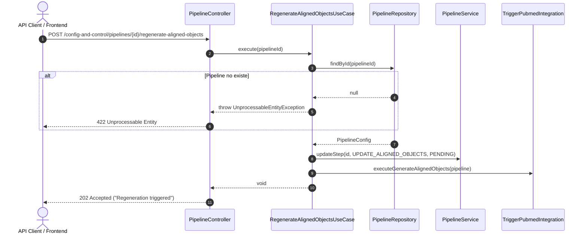

# Caso de Uso: `RegenerateAlignedObjectsUseCase`

- **Clase:** `com.biopatternsg.application.usecase.RegenerateAlignedObjectsUseCase`
- **Puerto de Entrada:** `com.biopatternsg.domain.port.in.RegenerateAlignedObjects`
- **Puertos de Salida:**
  - `com.biopatternsg.domain.port.out.repositories.PipelineRepository`
  - `com.biopatternsg.domain.port.out.TriggerPubmedIntegration`
- **Servicios de Dominio Involucrados:**
  - `com.biopatternsg.domain.services.PipelineService`
- **Controlador Invocador:** `com.biopatternsg.infrastructure.adapters.in.restcontrollers.PipelineController`

---

## 1. Propósito
Reinicia el paso de confirmación de objetos expertos alineados (`UPDATE_ALIGNED_OBJECTS`) a estado `PENDING` y vuelve a disparar la generación de objetos alineados en el servicio externo `pubmed-integration`.

---

## 2. Flujo de Ejecución

1. Recibe el `pipelineId`.
2. Busca el pipeline en `PipelineRepository.findById(pipelineId)`. Si no existe, lanza `UnprocessableEntityException("The pipeline don't exists")`.
3. Actualiza el paso `PipelineSteps.UPDATE_ALIGNED_OBJECTS` a `Status.PENDING` mediante `PipelineService.updateStep(...)`.
4. Dispara la generación llamando a `TriggerPubmedIntegration.executeGenerateAlignedObjects(pipeline)`.

---

## 3. Diagrama de Flujo (Mermaid)

