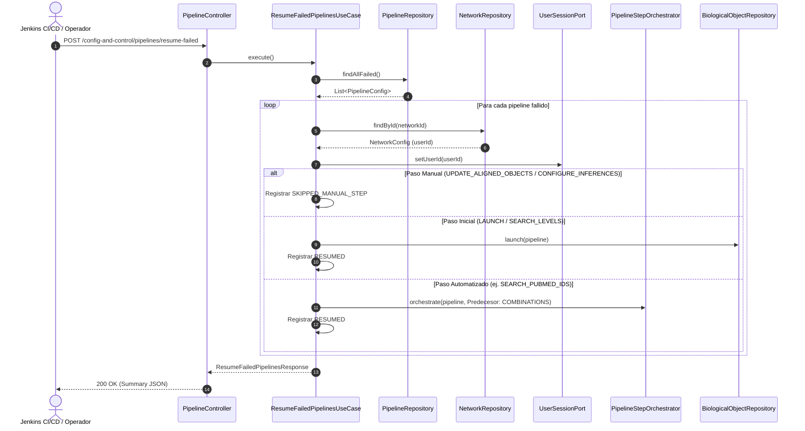

# Caso de Uso: `ResumeFailedPipelinesUseCase`

- **Clase:** `com.biopatternsg.application.usecase.ResumeFailedPipelinesUseCase`
- **Puerto de Entrada:** `com.biopatternsg.domain.port.in.ResumeFailedPipelines`
- **Puertos de Salida:**
  - `com.biopatternsg.domain.port.out.repositories.PipelineRepository`
  - `com.biopatternsg.domain.port.out.repositories.NetworkRepository`
  - `com.biopatternsg.domain.port.out.repositories.BiologicalObjectRepository`
  - `com.biopatternsg.domain.port.out.UserSessionPort`
- **Servicios de Aplicación Involucrados:**
  - `com.biopatternsg.application.services.PipelineStepOrchestrator`
- **Controlador Invocador:** `com.biopatternsg.infrastructure.adapters.in.restcontrollers.PipelineController`

---

## 1. Propósito
Detecta y reanuda automáticamente todos los pipelines que quedaron en estado `FAILED` (por ejemplo tras reinicios, fallas de red o despliegues de contenedores). Para cada pipeline, resuelve el contexto del usuario propietario a través de su red asociada, calcula el paso predecesor y lo re-despacha a través del orquestador de pasos (`PipelineStepOrchestrator`), excluyendo de forma segura los pasos de revisión manual (`UPDATE_ALIGNED_OBJECTS` y `CONFIGURE_INFERENCES`) y aislando los errores individuales para garantizar que un fallo en un pipeline no bloquee el lote.

---

## 2. Flujo de Ejecución

1. Consulta todos los pipelines en estado `FAILED` mediante `PipelineRepository.findAllFailed()`. Si la lista está vacía, retorna un resumen con contadores en cero.
2. Para cada pipeline en la lista:
   - Determina el paso fallido (`failedStep`) analizando el historial de estados de la entidad.
   - Resuelve el `userId` propietario consultando `NetworkRepository.findById(pipeline.getNetworkId())` y lo establece en el contexto mediante `UserSessionPort.setUserId(userId)`.
   - Si el paso fallido es manual (`UPDATE_ALIGNED_OBJECTS` o `CONFIGURE_INFERENCES`), omite el auto-despacho, registra el detalle `SKIPPED_MANUAL_STEP` e incrementa el contador de omitidos (`skipped`).
   - Si el paso fallido es automatizado:
     - Si falló en `LAUNCH` o `SEARCH_LEVELS`, relanza el proceso de descubrimiento biológico (`BiologicalObjectRepository.launch(pipeline)`).
     - Si falló en pasos intermedios (`COMBINATIONS`, `SEARCH_PUBMED_IDS`, `SEARCH_PUBTATOR`, `BUILD_KNOWLEDGE_BASE`, `GENERATE_ALIGNED_OBJECTS` o `FIND_ROLES`), calcula el paso predecesor e invoca `PipelineStepOrchestrator.orchestrate(pipeline, predecessorStep)`.
     - Registra el detalle `RESUMED` e incrementa `resumed`.
   - Aislamiento de excepciones: si el re-despacho de un pipeline individual arroja un error, captura la excepción, registra el detalle `ERROR` e incrementa `errors`, continuando con los demás pipelines del lote.
3. Retorna un objeto `ResumeFailedPipelinesResponse` con los totales y lista pormenorizada de ejecuciones.

---

## 3. Diagrama de Flujo (Mermaid)

