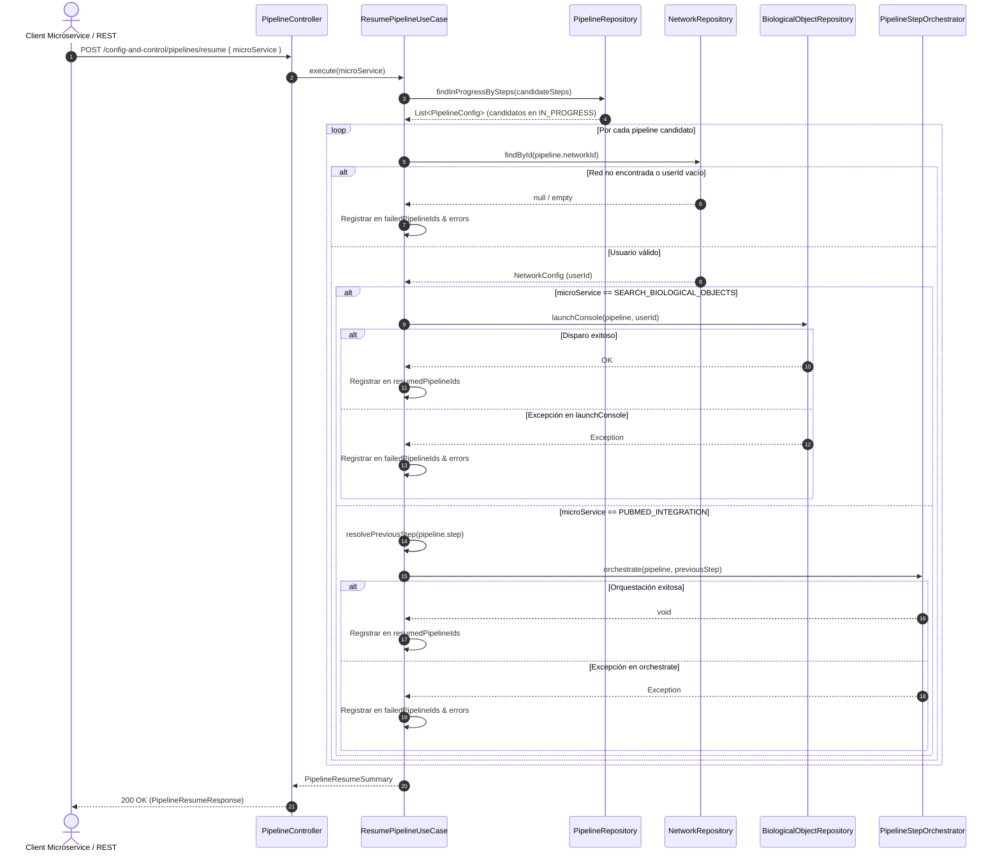

# Caso de Uso: `ResumePipelineUseCase`

- **Clase:** `com.biopatternsg.application.usecase.ResumePipelineUseCase`
- **Puerto de Entrada:** `com.biopatternsg.domain.port.in.ResumePipeline`
- **Puertos de Salida:**
  - `com.biopatternsg.domain.port.out.repositories.PipelineRepository`
  - `com.biopatternsg.domain.port.out.repositories.NetworkRepository`
  - `com.biopatternsg.domain.port.out.repositories.BiologicalObjectRepository`
- **Servicios de Aplicación:**
  - `com.biopatternsg.application.services.PipelineStepOrchestrator`
- **Controlador Invocador:** `com.biopatternsg.infrastructure.adapters.in.restcontrollers.PipelineController`

---

## 1. Problema de Negocio e Intención
Proporcionar un mecanismo de auto-recuperación (*self-healing*) desatendido para pipelines biológicos que quedaron interrumpidos en estado `IN_PROGRESS` tras reinicios de contenedores, caídas imprevistas o redespliegues de servicios en el ecosistema BioPatternsG.

Permite que:
- El microservicio `search-biological-objects` detone la reanudación de pipelines en pasos biológicos 2 al 4 (`TRANSCRIPTION_FACTOR`, `EXPERT_OBJECTS`, `SEARCH_LEVELS`).
- El microservicio `pubmed-integration` detone la reanudación de pipelines en pasos 5 al 9 (`COMBINATIONS`, `SEARCH_PUBMED_IDS`, `SEARCH_PUBTATOR`, `BUILD_KNOWLEDGE_BASE`, `GENERATE_ALIGNED_OBJECTS`).

---

## 2. Flujo de Ejecución Paso a Paso

1. **Determinación del Rango de Pasos Candidatos:**
   - Si `microService == SEARCH_BIOLOGICAL_OBJECTS`: candidatos son pasos `[TRANSCRIPTION_FACTOR, EXPERT_OBJECTS, SEARCH_LEVELS]`.
   - Si `microService == PUBMED_INTEGRATION`: candidatos son pasos `[COMBINATIONS, SEARCH_PUBMED_IDS, SEARCH_PUBTATOR, BUILD_KNOWLEDGE_BASE, GENERATE_ALIGNED_OBJECTS]`.
2. **Consulta en Base de Datos:**
   - Invoca `PipelineRepository.findInProgressBySteps(candidateSteps)` filtrando pipelines cuyo paso pertenezca al rango y cuyo último estado registrado en `statuses` sea `Status.IN_PROGRESS`.
3. **Procesamiento Resiliente de Lote (Por cada Pipeline):**
   - **Resolución de Usuario Propietario:** Consulta `NetworkRepository.findById(pipeline.getNetworkId())` para extraer el `userId`.
     - Si la red no existe o `userId` está vacío, se registra fallo individual en `failedPipelineIds` y `errors`, sin abortar el lote.
   - **Disparo de la Reanudación:**
     - Si `SEARCH_BIOLOGICAL_OBJECTS`: Invoca `BiologicalObjectRepository.launchConsole(pipeline, userId)` pasando el `userId` recuperado de forma explícita.
     - Si `PUBMED_INTEGRATION`: Determina el paso inmediatamente predecesor (`COMBINATIONS` -> `SEARCH_LEVELS`, `SEARCH_PUBMED_IDS` -> `COMBINATIONS`, `SEARCH_PUBTATOR` -> `SEARCH_PUBMED_IDS`, `BUILD_KNOWLEDGE_BASE` -> `SEARCH_PUBTATOR`, `GENERATE_ALIGNED_OBJECTS` -> `BUILD_KNOWLEDGE_BASE`) e invoca `PipelineStepOrchestrator.orchestrate(pipeline, previousStep)`.
   - **Registro de Resultado:** Si el relanzamiento es exitoso, añade el ID a `resumedPipelineIds`. Si ocurre una excepción, la captura, añade el ID a `failedPipelineIds` y la causa a `errors`.
4. **Consolidación del Resumen:**
   - Retorna un `PipelineResumeSummary` con `microService`, `totalFound`, `resumedCount`, `failedCount`, listas de IDs y detalle de errores, cumpliendo con el invariante `totalFound == resumedCount + failedCount`.

---

## 3. Diagrama de Flujo (Mermaid)

---

## 4. Catálogo de Errores y Excepciones de Dominio

| Escenario de Error | Nivel | Manejo y Respuesta |
|---|---|---|
| `microService` es nulo o ausente en el payload | Capa de Entrega / REST | Retorna `400 Bad Request` con mensaje descriptivo de validación. |
| Red no encontrada para un pipeline candidato | Nivel de Ítem (Lote) | Se registra en `failedPipelineIds` con motivo `"Cannot resolve userId for network: <id>"` sin abortar el resto del lote. |
| Excepción de red / cliente HTTP en `launchConsole()` | Nivel de Ítem (Lote) | Se captura defensivamente; añade el ID a `failedPipelineIds` y el mensaje de excepción al mapa `errors`. |
| Excepción de orquestación en `orchestrate()` | Nivel de Ítem (Lote) | Se captura defensivamente; añade el ID a `failedPipelineIds` y el motivo al mapa `errors`. |
| Paso sin predecesor identificado | Nivel de Ítem (Lote) | Se registra fallo `"Cannot determine predecessor step for step: <step>"`. |
