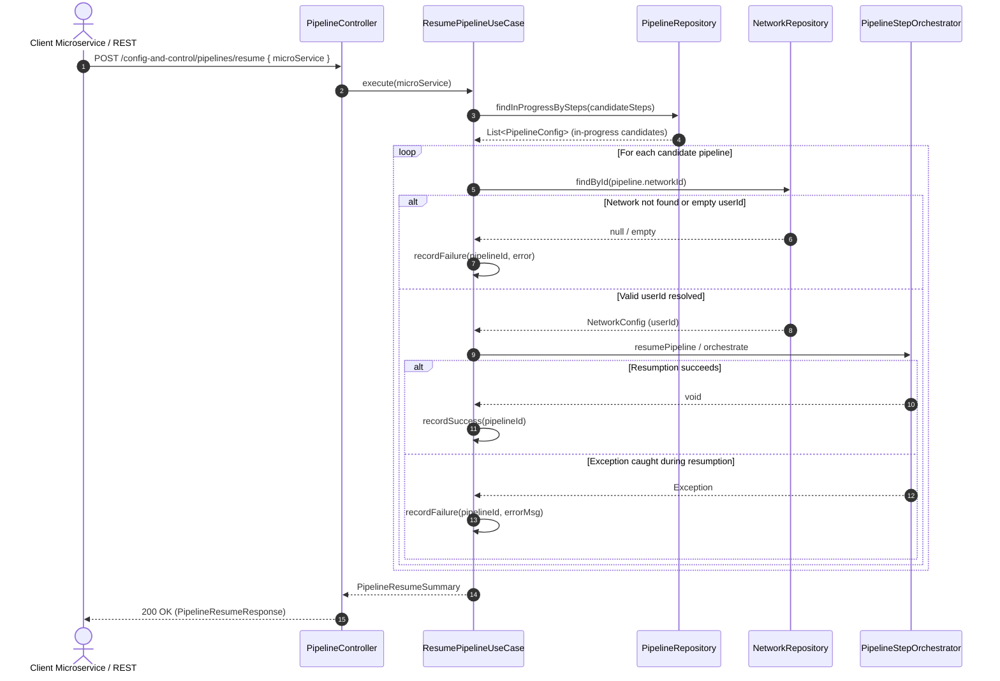

# Use Case: `ResumePipelineUseCase`

- **Class:** `com.biopatternsg.application.usecase.ResumePipelineUseCase`
- **Inbound Port:** `com.biopatternsg.domain.port.in.ResumePipeline`
- **Outbound Ports:**
  - `com.biopatternsg.domain.port.out.repositories.PipelineRepository`
  - `com.biopatternsg.domain.port.out.repositories.NetworkRepository`
- **Application Services:**
  - `com.biopatternsg.application.services.PipelineStepOrchestrator`
- **Invoking Controller:** `com.biopatternsg.infrastructure.adapters.in.restcontrollers.PipelineController`

---

## 1. Business Problem & Purpose
Provides an unattended self-healing mechanism for biological pipelines that were interrupted in `IN_PROGRESS` status due to container restarts, unexpected crashes, or service redeployments in the BioPatternsG ecosystem.

The use case acts as a **lightweight orchestrator** (Constitution Principle II): it coordinates batch retrieval, user resolution per network, and delegates resumption execution to `PipelineStepOrchestrator`, keeping all method signatures within the 3-parameter limit.

---

## 2. Step-by-Step Execution Flow

1. **Candidate Step Range Resolution:**
   - If `microService == SEARCH_BIOLOGICAL_OBJECTS`: candidate steps are `[LAUNCH, TRANSCRIPTION_FACTOR, EXPERT_OBJECTS, SEARCH_LEVELS]`.
   - If `microService == PUBMED_INTEGRATION`: candidate steps are `[COMBINATIONS, SEARCH_PUBMED_IDS, SEARCH_PUBTATOR, BUILD_KNOWLEDGE_BASE, GENERATE_ALIGNED_OBJECTS]`.
2. **Database Query:**
   - Invokes `PipelineRepository.findInProgressBySteps(candidateSteps)` to retrieve all pipelines currently in progress within those steps.
3. **Resilient Batch Processing:**
   - For each candidate pipeline:
     - **Owner User Resolution:** Queries `NetworkRepository.findById(pipeline.getNetworkId())` to extract `userId`.
       - If the network does not exist or `userId` is blank, records a failure for that pipeline (`"Cannot resolve userId..."`).
     - **Delegated Resumption Trigger:** Dispatches the pipeline resumption to the target microservice (`SEARCH_BIOLOGICAL_OBJECTS` via `BiologicalObjectRepository.launchConsole` or `PUBMED_INTEGRATION` via `PipelineStepOrchestrator` using the predecessor step).
       - On success, records the pipeline ID in `resumedPipelineIds`.
       - On exception, catches the error, records the pipeline ID in `failedPipelineIds`, and stores the error message in `errors`.
4. **Summary Consolidation:**
   - Builds and returns `PipelineResumeSummary` with totals and per-pipeline error details, satisfying the invariant `totalFound == resumedCount + failedCount`.

---

## 3. Sequence Diagram (Mermaid)

---

## 4. Error Catalog & Domain Exceptions

| Error Scenario | Scope | Handling & Response |
|---|---|---|
| `microService` is null or missing in request payload | Delivery / REST Layer | Returns `400 Bad Request` with validation message. |
| Network not found for a candidate pipeline | Item Level (Batch) | Recorded as a failed item with reason `"Cannot resolve userId for network: <id>"` without aborting the batch. |
| Network / HTTP client exception during resumption | Item Level (Batch) | Caught defensively; adds ID to `failedPipelineIds` and message to `errors` map. |
| Predecessor step resolution exception | Item Level (Batch) | Caught defensively; adds ID to `failedPipelineIds` and reason to `errors` map. |
