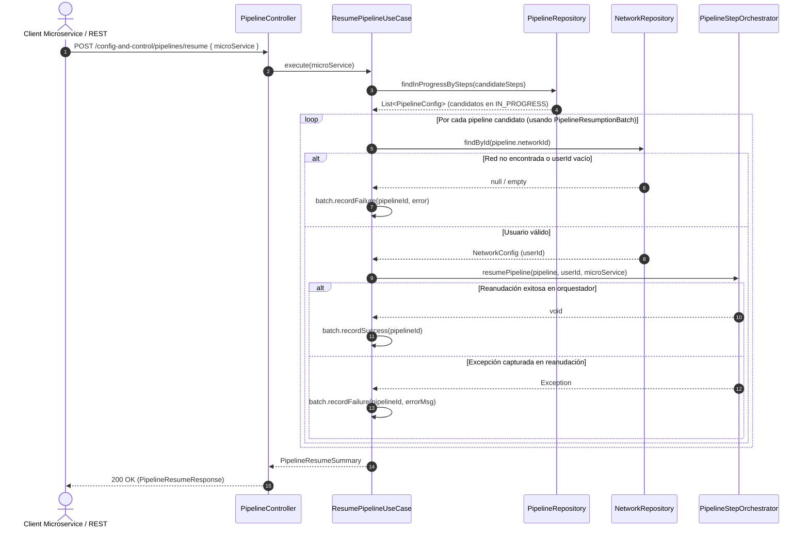

# Caso de Uso: `ResumePipelineUseCase`

- **Clase:** `com.biopatternsg.application.usecase.ResumePipelineUseCase`
- **Puerto de Entrada:** `com.biopatternsg.domain.port.in.ResumePipeline`
- **Puertos de Salida:**
  - `com.biopatternsg.domain.port.out.repositories.PipelineRepository`
  - `com.biopatternsg.domain.port.out.repositories.NetworkRepository`
- **Servicios de Aplicación:**
  - `com.biopatternsg.application.services.PipelineStepOrchestrator`
- **Controlador Invocador:** `com.biopatternsg.infrastructure.adapters.in.restcontrollers.PipelineController`

---

## 1. Problema de Negocio e Intención
Proporcionar un mecanismo de auto-recuperación (*self-healing*) desatendido para pipelines biológicos que quedaron interrumpidos en estado `IN_PROGRESS` tras reinicios de contenedores, caídas imprevistas o redespliegues de servicios en el ecosistema BioPatternsG.

El caso de uso opera como un **orquestador liviano** (Principio II de la Constitución): coordina la recuperación por lote, la resolución de usuario por red y delega la ejecución de la reanudación a `PipelineStepOrchestrator.resumePipeline(...)`, manteniendo todas sus firmas con un máximo de 3 parámetros mediante el acumulador `PipelineResumptionBatch`.

---

## 2. Flujo de Ejecución Paso a Paso

1. **Determinación del Rango de Pasos Candidatos:**
   - Si `microService == SEARCH_BIOLOGICAL_OBJECTS`: candidatos son pasos `[LAUNCH, TRANSCRIPTION_FACTOR, EXPERT_OBJECTS, SEARCH_LEVELS]`.
   - Si `microService == PUBMED_INTEGRATION`: candidatos son pasos `[COMBINATIONS, SEARCH_PUBMED_IDS, SEARCH_PUBTATOR, BUILD_KNOWLEDGE_BASE, GENERATE_ALIGNED_OBJECTS]`.
2. **Consulta en Base de Datos:**
   - Invoca `PipelineRepository.findInProgressBySteps(candidateSteps)` filtrando pipelines cuyo paso pertenezca al rango y esté en progreso.
3. **Procesamiento Resiliente de Lote (`PipelineResumptionBatch`):**
   - Para cada pipeline candidato, invoca `processPipeline(pipeline, microService, batch)` (3 parámetros):
     - **Resolución de Usuario Propietario:** Consulta `NetworkRepository.findById(pipeline.getNetworkId())` para extraer el `userId`.
       - Si la red no existe o `userId` está vacío, invoca `batch.recordFailure(pipelineId, "Cannot resolve userId...")`.
     - **Disparo Delegado de Reanudación:** Invoca `pipelineStepOrchestrator.resumePipeline(pipeline, userId, microService)`.
       - `PipelineStepOrchestrator` evalúa los pasos predecesores (en caso de PubMed) o detona la computación biológica.
       - Si es exitoso, invoca `batch.recordSuccess(pipelineId)`.
       - Si ocurre una excepción, la captura e invoca `batch.recordFailure(pipelineId, errorMsg)`.
4. **Consolidación del Resumen:**
   - Retorna `batch.toSummary(microService, candidates.size())` con los totales y detalle de errores, cumpliendo con el invariante `totalFound == resumedCount + failedCount`.

---

## 3. Diagrama de Flujo (Mermaid)

---

## 4. Catálogo de Errores y Excepciones de Dominio

| Escenario de Error | Nivel | Manejo y Respuesta |
|---|---|---|
| `microService` es nulo o ausente en el payload | Capa de Entrega / REST | Retorna `400 Bad Request` con mensaje descriptivo de validación. |
| Red no encontrada para un pipeline candidato | Nivel de Ítem (Lote) | Se registra en el batch como fallo con motivo `"Cannot resolve userId for network: <id>"` sin abortar el resto del lote. |
| Excepción de red / cliente HTTP en reanudación | Nivel de Ítem (Lote) | Se captura defensivamente; añade el ID a fallidos y el mensaje de excepción al mapa `errors`. |
| Excepción de orquestación en predecesor | Nivel de Ítem (Lote) | Se captura defensivamente; añade el ID a fallidos y el motivo al mapa `errors`. |
