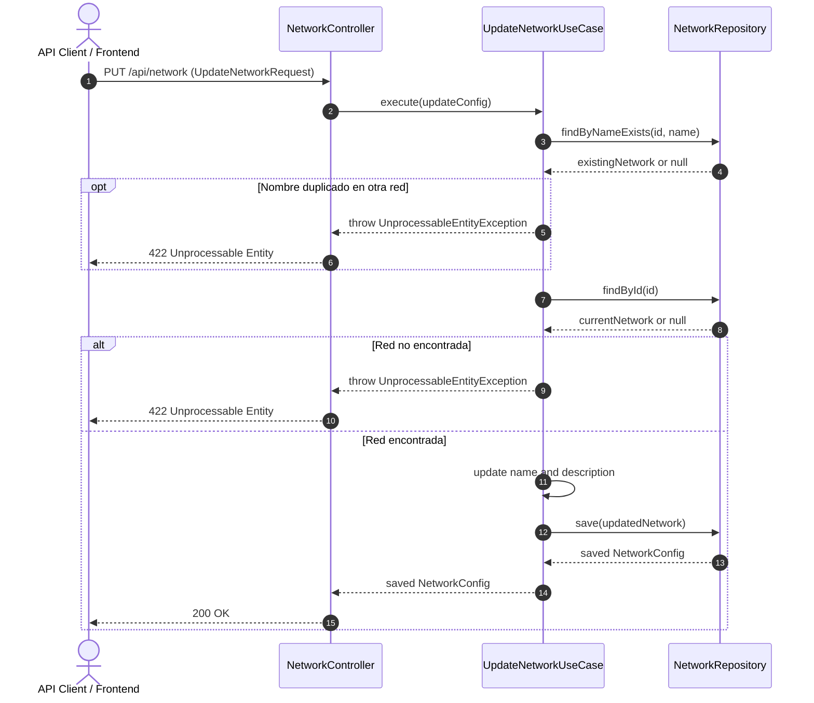

# Caso de Uso: `UpdateNetworkUseCase`

- **Clase:** `com.biopatternsg.application.usecase.UpdateNetworkUseCase`
- **Puerto de Entrada:** `com.biopatternsg.domain.port.in.UpdateNetwork`
- **Puerto de Salida:** `com.biopatternsg.domain.port.out.repositories.NetworkRepository`
- **Controlador Invocador:** `com.biopatternsg.infrastructure.adapters.in.restcontrollers.NetworkController`

---

## 1. Propósito
Actualiza los datos básicos de una red biológica existente (nombre y descripción), validando que la red exista previamente y que el nuevo nombre no colisione con el de otra red distinta.

---

## 2. Flujo de Ejecución

1. Recibe la configuración de actualización `NetworkConfig` (debe contener `id`, `name`, `description`).
2. Verifica mediante `NetworkRepository.findByNameExists(id, name)` si otra red diferente ya posee ese nombre. Si existe, lanza `UnprocessableEntityException("The network already exists")`.
3. Busca la red actual mediante `NetworkRepository.findById(id)`. Si no existe, lanza `UnprocessableEntityException("The network don't exists")`.
4. Asigna los nuevos valores de `name` y `description` sobre la entidad existente.
5. Persiste y retorna la entidad actualizada a través de `NetworkRepository.save(...)`.

---

## 3. Diagrama de Flujo (Mermaid)

