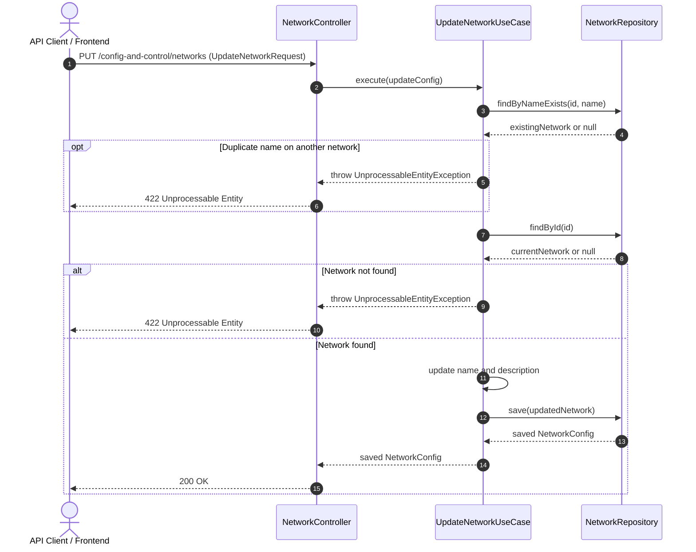

# Use Case: `UpdateNetworkUseCase`

- **Class:** `com.biopatternsg.application.usecase.UpdateNetworkUseCase`
- **Inbound Port:** `com.biopatternsg.domain.port.in.UpdateNetwork`
- **Outbound Port:** `com.biopatternsg.domain.port.out.repositories.NetworkRepository`
- **Invoking Controller:** `com.biopatternsg.infrastructure.adapters.in.restcontrollers.NetworkController`

---

## 1. Purpose
Updates the basic attributes of an existing biological network (name and description), validating both that the network exists and that the new name does not collide with another existing network.

---

## 2. Execution Flow

1. Receives the update configuration `NetworkConfig` (containing `id`, `name`, `description`).
2. Checks via `NetworkRepository.findByNameExists(id, name)` whether another distinct network already uses that name. If so, throws `UnprocessableEntityException("The network already exists")`.
3. Retrieves the current network via `NetworkRepository.findById(id)`. If not found, throws `UnprocessableEntityException("The network don't exists")`.
4. Updates `name` and `description` on the existing entity.
5. Persists and returns the updated entity via `NetworkRepository.save(...)`.

---

## 3. Sequence Diagram (Mermaid)

---

## 4. Error Cases

- **Duplicate Name on Another Network:** Throws `UnprocessableEntityException("The network already exists")`.
- **Network Not Found:** Throws `UnprocessableEntityException("The network don't exists")`.
