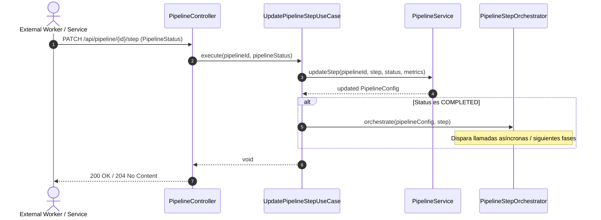

# Caso de Uso: `UpdatePipelineStepUseCase`

- **Clase:** `com.biopatternsg.application.usecase.UpdatePipelineStepUseCase`
- **Puerto de Entrada:** `com.biopatternsg.domain.port.in.UpdatePipelineStep`
- **Servicios de Aplicación Involucrados:**
  - `com.biopatternsg.application.services.PipelineService`
  - `com.biopatternsg.application.services.PipelineStepOrchestrator`
- **Controlador Invocador:** `com.biopatternsg.infrastructure.adapters.in.restcontrollers.PipelineController`

---

## 1. Propósito
Actualiza el estado de ejecución y métricas de un paso particular (`PipelineSteps`) dentro del pipeline (ej. `IN_PROGRESS`, `COMPLETED`, `FAILED`). Si el estado pasa a `COMPLETED`, dispara automáticamente el orquestador (`PipelineStepOrchestrator`) para transicionar o disparar la siguiente fase del pipeline biológico.

---

## 2. Flujo de Ejecución

1. Recibe el `pipelineId` y el objeto `PipelineStatus` (con `step`, `status` y `metrics`).
2. Llama a `PipelineService.updateStep(pipelineId, step, status, metrics)` para registrar el progreso y persistir el nuevo estado en el histórico.
3. Si `status == Status.COMPLETED`, invoca a `PipelineStepOrchestrator.orchestrate(pipelineConfig, step)` para desencadenar el siguiente paso correspondiente en los servicios externos (`inferences`, `pubmed-integration`, etc.).
4. Registra en el log la actualización del paso.

---

## 3. Diagrama de Flujo (Mermaid)

