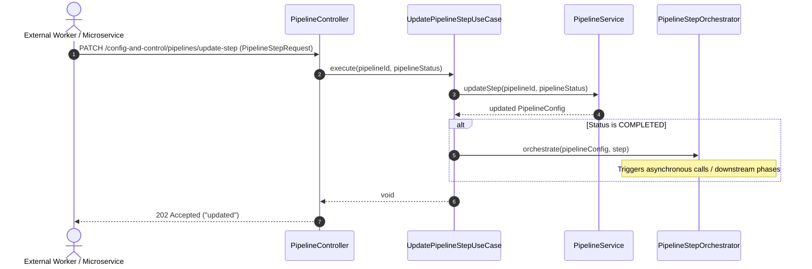

# Use Case: `UpdatePipelineStepUseCase`

- **Class:** `com.biopatternsg.application.usecase.UpdatePipelineStepUseCase`
- **Inbound Port:** `com.biopatternsg.domain.port.in.UpdatePipelineStep`
- **Application Services Involved:**
  - `PipelineService`
  - `com.biopatternsg.application.services.PipelineStepOrchestrator`
- **Invoking Controller:** `com.biopatternsg.infrastructure.adapters.in.restcontrollers.PipelineController`

---

## 1. Purpose
Updates the execution status and metrics of a specific step (`PipelineSteps`) within a pipeline (e.g., `IN_PROGRESS`, `COMPLETED`, `FAILED`). When a step transitions to `COMPLETED`, it automatically invokes `PipelineStepOrchestrator` to advance or trigger the next phase of the biological pipeline.

---

## 2. Execution Flow

1. Receives `pipelineId` and the `PipelineStatus` domain object (containing `step`, `status`, and `metrics`).
2. Calls `PipelineService.updateStep(...)` to record the step status and metrics and persist the updated history.
3. If `status == Status.COMPLETED`, invokes `PipelineStepOrchestrator.orchestrate(pipelineConfig, step)` to trigger the next corresponding phase across external microservices (`inferences`, `pubmed-integration`, etc.).
4. Logs the step update completion.

---

## 3. Sequence Diagram (Mermaid)

---

## 4. Error Cases

- **Non-existent Pipeline:** `PipelineService` throws `UnprocessableEntityException("The pipeline don't exists")` if `pipelineId` does not exist.
