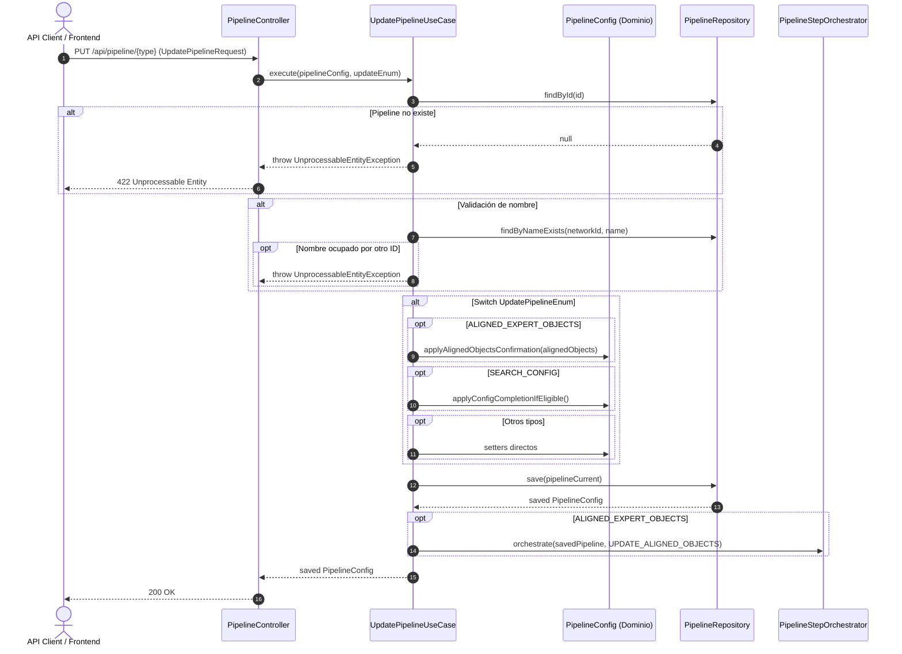

# Caso de Uso: `UpdatePipelineUseCase`

- **Clase:** `com.biopatternsg.application.usecase.UpdatePipelineUseCase`
- **Puerto de Entrada:** `com.biopatternsg.domain.port.in.UpdatePipeline`
- **Puerto de Salida:** `com.biopatternsg.domain.port.out.repositories.PipelineRepository`
- **Servicios de Aplicación Involucrados:** `com.biopatternsg.application.services.PipelineStepOrchestrator`
- **Controlador Invocador:** `com.biopatternsg.infrastructure.adapters.in.restcontrollers.PipelineController`

---

## 1. Propósito
Actúa como un **orquestador liviano** (Principio II de la Constitución) que coordina la actualización modular de secciones específicas de un pipeline de acuerdo al enumerado `UpdatePipelineEnum`:
- `DESCRIPTION`: Modifica nombre y descripción.
- `TRANSCRIPTION_FACTOR`: Configura factores de transcripción.
- `EXPERT_OBJETS`: Configura objetos expertos.
- `SEARCH_CONFIG`: Actualiza filtros y parámetros de búsqueda, delegando la verificación de completitud a la invariante de dominio `pipelineCurrent.applyConfigCompletionIfEligible()`.
- `ALIGNED_EXPERT_OBJECTS`: Confirma objetos alineados y genera métricas delegando a la invariante de dominio `pipelineCurrent.applyAlignedObjectsConfirmation(...)`, detonando la orquestación del siguiente paso.

---

## 2. Flujo de Ejecución

1. Valida que el pipeline exista en el repositorio (`PipelineRepository.findById(id)`).
2. Valida unicidad de nombre dentro de la misma red (`PipelineRepository.findByNameExists(networkId, name)`).
3. Aplica los cambios delegando a invariantes de dominio en `PipelineConfig`:
   - `ALIGNED_EXPERT_OBJECTS`: Invoca `pipelineCurrent.applyAlignedObjectsConfirmation(...)`.
   - `SEARCH_CONFIG`: Actualiza parámetros y evalúa completitud mediante `pipelineCurrent.applyConfigCompletionIfEligible()`.
   - `DESCRIPTION`, `TRANSCRIPTION_FACTOR`, `EXPERT_OBJETS`: Actualiza las propiedades correspondientes.
4. Persiste el pipeline actualizado mediante `PipelineRepository.save(pipelineCurrent)`.
5. Si el tipo de actualización fue `ALIGNED_EXPERT_OBJECTS`, invoca `pipelineStepOrchestrator.orchestrate(savedPipeline, PipelineSteps.UPDATE_ALIGNED_OBJECTS)`.
6. Retorna el `PipelineConfig` persistido.

---

## 3. Diagrama de Flujo (Mermaid)

---

## 4. Casos de Error

- **Pipeline Inexistente:** Se lanza `UnprocessableEntityException("The pipeline don't exists")` si el ID no se encuentra en el repositorio.
- **Colisión de Nombres:** Se lanza `UnprocessableEntityException("The pipeline name already exists")` si ya existe otro pipeline con el mismo nombre en la red.
