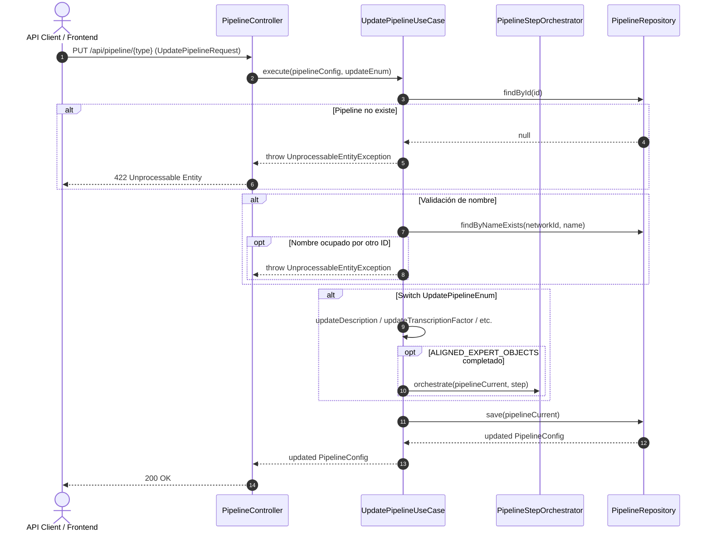

# Caso de Uso: `UpdatePipelineUseCase`

- **Clase:** `com.biopatternsg.application.usecase.UpdatePipelineUseCase`
- **Puerto de Entrada:** `com.biopatternsg.domain.port.in.UpdatePipeline`
- **Puerto de Salida:** `com.biopatternsg.domain.port.out.repositories.PipelineRepository`
- **Servicios de Aplicación Involucrados:** `com.biopatternsg.application.services.PipelineStepOrchestrator`
- **Controlador Invocador:** `com.biopatternsg.infrastructure.adapters.in.restcontrollers.PipelineController`

---

## 1. Propósito
Permite actualizar modularmente secciones específicas de la configuración de un pipeline de acuerdo al enumerado `UpdatePipelineEnum`:
- `DESCRIPTION`: Modifica nombre y descripción.
- `TRANSCRIPTION_FACTOR`: Configura factores de transcripción y sus umbrales.
- `EXPERT_OBJETS`: Configura objetos expertos y niveles de confianza.
- `SEARCH_CONFIG`: Actualiza filtros y parámetros de búsqueda.
- `ALIGNED_EXPERT_OBJECTS`: Guarda el alineamiento de objetos expertos y opcionalmente dispara la orquestación del siguiente paso.

---

## 2. Flujo de Ejecución

1. Valida que el pipeline exista (`PipelineRepository.findById(id)`).
2. Si se renombra, valida que no colisione con otro pipeline en la misma red.
3. Ejecuta la actualización puntual según `UpdatePipelineEnum`:
   - Aplica los cambios sobre la entidad `pipelineCurrent`.
   - Modifica el estado del paso o agrega métricas cuando aplique.
4. Para `ALIGNED_EXPERT_OBJECTS`, invoca `pipelineStepOrchestrator.orchestrate(...)` si se concluye la etapa de alineación.
5. Persiste el pipeline actualizado mediante `PipelineRepository.save(pipelineCurrent)`.

---

## 3. Diagrama de Flujo (Mermaid)

