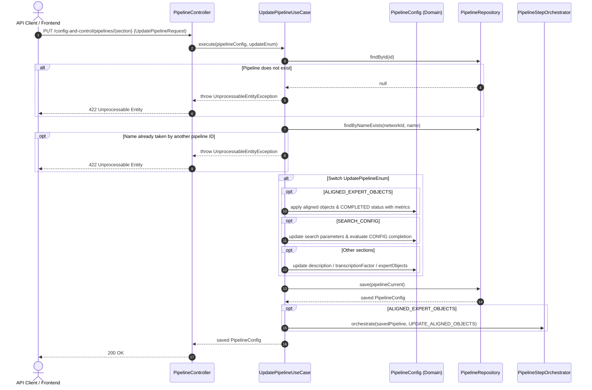

# Use Case: `UpdatePipelineUseCase`

- **Class:** `com.biopatternsg.application.usecase.UpdatePipelineUseCase`
- **Inbound Port:** `com.biopatternsg.domain.port.in.UpdatePipeline`
- **Outbound Port:** `com.biopatternsg.domain.port.out.repositories.PipelineRepository`
- **Application Services Involved:** `com.biopatternsg.application.services.PipelineStepOrchestrator`
- **Invoking Controller:** `com.biopatternsg.infrastructure.adapters.in.restcontrollers.PipelineController`

---

## 1. Purpose
Acts as a **lightweight orchestrator** (Constitution Principle II) that coordinates modular updates to specific sections of a pipeline configuration according to `UpdatePipelineEnum`:
- `DESCRIPTION`: Updates the pipeline description.
- `TRANSCRIPTION_FACTOR`: Configures transcription factor parameters and sources.
- `EXPERT_OBJETS`: Configures expert biological objects.
- `SEARCH_CONFIG`: Updates search levels, `retMax`, `maxComplexes`, and `useOnlyPrincipalName`, evaluating whether `PipelineSteps.CONFIG` is eligible to transition to `Status.COMPLETED`.
- `ALIGNED_EXPERT_OBJECTS`: Confirms aligned expert objects, records alignment metrics, marks `UPDATE_ALIGNED_OBJECTS` as `COMPLETED`, and triggers `PipelineStepOrchestrator` for the next phase.

---

## 2. Execution Flow

1. Validates that the pipeline exists in the repository (`PipelineRepository.findById(id)`). If not found, throws `UnprocessableEntityException("The pipeline don't exists")`.
2. Validates name uniqueness within the same network (`PipelineRepository.findByNameExists(networkId, name)`). If a distinct pipeline already has that name, throws `UnprocessableEntityException("The pipeline name already exists")`.
3. Applies the section update according to `UpdatePipelineEnum`:
   - `ALIGNED_EXPERT_OBJECTS`: Updates aligned objects, records metrics, and sets `UPDATE_ALIGNED_OBJECTS` to `COMPLETED`.
   - `SEARCH_CONFIG`: Updates search configuration fields and transitions `CONFIG` to `COMPLETED` if all required fields are populated.
   - `DESCRIPTION`, `TRANSCRIPTION_FACTOR`, `EXPERT_OBJETS`: Updates the respective properties on `pipelineCurrent`.
4. Persists the updated pipeline via `PipelineRepository.save(pipelineCurrent)`.
5. If `pipelineEnum == UpdatePipelineEnum.ALIGNED_EXPERT_OBJECTS`, invokes `pipelineStepOrchestrator.orchestrate(savedPipeline, PipelineSteps.UPDATE_ALIGNED_OBJECTS)`.
6. Returns the persisted `PipelineConfig`.

---

## 3. Sequence Diagram (Mermaid)

---

## 4. Error Cases

- **Non-existent Pipeline:** Throws `UnprocessableEntityException("The pipeline don't exists")` if the ID is not found in the repository.
- **Name Collision:** Throws `UnprocessableEntityException("The pipeline name already exists")` if another pipeline with the same name already exists in the network.
