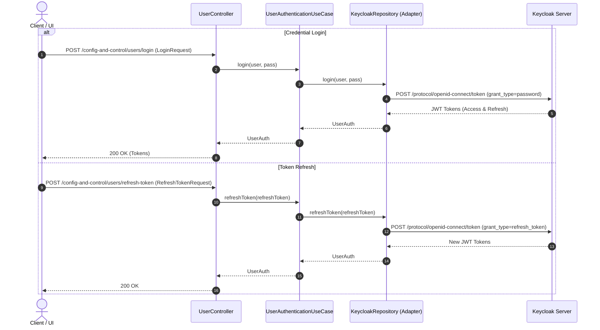

# Use Case: `UserAuthenticationUseCase`

- **Class:** `com.biopatternsg.application.usecase.UserAuthenticationUseCase`
- **Inbound Port:** `com.biopatternsg.domain.port.in.UserAuthentication`
- **Outbound Port:** `com.biopatternsg.domain.port.out.repositories.KeycloakRepository`
- **Invoking Controller:** `com.biopatternsg.infrastructure.adapters.in.restcontrollers.UserController`

---

## 1. Purpose
Manages user authentication against the central identity provider (**Keycloak**), supporting both direct credential login and session renewal via refresh tokens (`refresh_token`).

---

## 2. Methods & Execution Flow

1. **`login(String user, String pass)`:**
   - Forwards user credentials to the outbound port `KeycloakRepository.login(user, pass)`.
   - Keycloak validates the credentials and returns OIDC tokens (`accessToken`, `refreshToken`, expiration metadata).
   - Returns the `UserAuth` domain object.
2. **`refreshToken(String refreshToken)`:**
   - Forwards the refresh token to `KeycloakRepository.refreshToken(refreshToken)`.
   - Keycloak issues a new valid `accessToken`.
   - Returns the updated `UserAuth` domain object.

---

## 3. Sequence Diagram (Mermaid)

---

## 4. Error Cases

- **Invalid Credentials or Expired Refresh Token:** `KeycloakAdapter` throws `KeycloakServiceException` with the upstream HTTP status code from Keycloak (e.g., `401 Unauthorized` or `400 Bad Request`).
