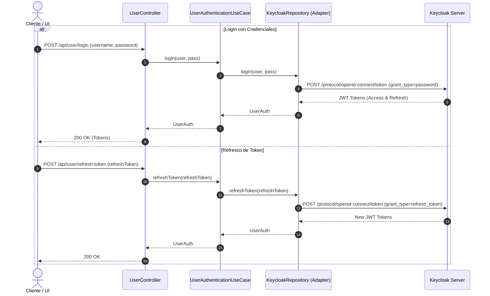

# Caso de Uso: `UserAuthenticationUseCase`

- **Clase:** `com.biopatternsg.application.usecase.UserAuthenticationUseCase`
- **Puerto de Entrada:** `com.biopatternsg.domain.port.in.UserAuthentication`
- **Puerto de Salida:** `com.biopatternsg.domain.port.out.repositories.KeycloakRepository`
- **Controlador Invocador:** `com.biopatternsg.infrastructure.adapters.in.restcontrollers.UserController`

---

## 1. Propósito
Gestiona la autenticación de usuarios contra el servidor de identidad central (**Keycloak**), permitiendo el inicio de sesión mediante credenciales directas y la renovación de sesiones mediante tokens de refresco (`refresh_token`).

---

## 2. Métodos y Flujo de Ejecución

1. **`login(String user, String pass)`:**
   - Envía las credenciales al puerto de salida `KeycloakRepository.login(user, pass)`.
   - Keycloak valida credenciales y retorna los tokens OIDC (`accessToken`, `refreshToken`, expiración).
   - Retorna el objeto de dominio `UserAuth`.
2. **`refreshToken(String refreshToken)`:**
   - Envía el token de refresco a `KeycloakRepository.refreshToken(refreshToken)`.
   - Keycloak emite un nuevo `accessToken` válido.
   - Retorna el objeto `UserAuth` actualizado.

---

## 3. Diagrama de Flujo (Mermaid)

