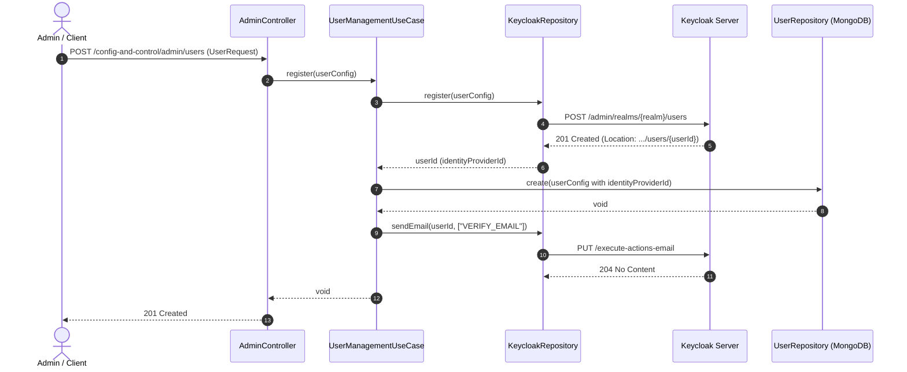

# Use Case: `UserManagementUseCase`

- **Class:** `com.biopatternsg.application.usecase.UserManagementUseCase`
- **Inbound Port:** `com.biopatternsg.domain.port.in.UserManagement`
- **Outbound Ports:**
  - `com.biopatternsg.domain.port.out.repositories.UserRepository`
  - `com.biopatternsg.domain.port.out.repositories.KeycloakRepository`
- **Invoking Controllers:**
  - `com.biopatternsg.infrastructure.adapters.in.restcontrollers.UserController`
  - `com.biopatternsg.infrastructure.adapters.in.restcontrollers.AdminController`

---

## 1. Purpose
Orchestrates the complete user lifecycle across the platform, maintaining synchronization between the external identity provider (**Keycloak**) and the local database (**MongoDB**). Covers user registration, email verification, password recovery, paginated listing, account activation/deactivation, and bulk user synchronization.

---

## 2. Core Operations

1. **`register(UserConfig userConfig)`:**
   - Registers the user in Keycloak via `KeycloakRepository.register(userConfig)` and obtains the generated `identityProviderId`.
   - Sets `identityProviderId` on `userConfig` and persists the profile in MongoDB (`UserRepository.create`).
   - Triggers the initial verification email via Keycloak (`VERIFY_EMAIL`).
2. **`processEmailVerification(String keycloakId)`:**
   - Webhook callback handler invoked when a user verifies their email in Keycloak.
   - Looks up the local user by `keycloakId`, sets `enabled = true`, and updates MongoDB.
3. **`recoveryPassword(String email)`:**
   - Looks up the user by email in MongoDB. If found, requests Keycloak to send an `UPDATE_PASSWORD` action email.
4. **`updateStatus(String id, boolean enabled)`:**
   - Updates the user's enabled status in both MongoDB and Keycloak (`updateEnabled`). Throws `UnprocessableEntityException("The user doesn't exist")` if the user ID does not exist.
5. **`syncUsers()`:**
   - Reconciliation task: fetches users from Keycloak and creates local MongoDB records for any user not yet present locally.
6. **`listUsers(UserConfig filters, int page, int size)`:**
   - Paginated filtered query delegated to `UserRepository.list(filters, page, size)`.

---

## 3. Sequence Diagram: User Registration (Mermaid)

---

## 4. Error Cases

- **User Not Found on Status Update:** Throws `UnprocessableEntityException("The user doesn't exist")` when `updateStatus` is called with an unknown user ID.
- **Keycloak Communication Error:** Throws `KeycloakServiceException` if Keycloak rejects registration, role assignment, or email dispatch.
