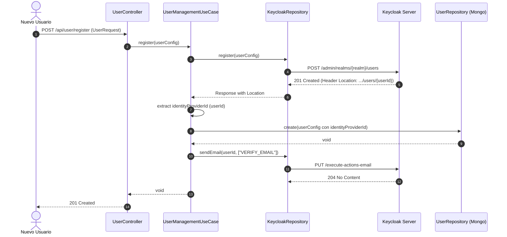

# Caso de Uso: `UserManagementUseCase`

- **Clase:** `com.biopatternsg.application.usecase.UserManagementUseCase`
- **Puerto de Entrada:** `com.biopatternsg.domain.port.in.UserManagement`
- **Puertos de Salida:**
  - `com.biopatternsg.domain.port.out.repositories.UserRepository`
  - `com.biopatternsg.domain.port.out.repositories.KeycloakRepository`
- **Controladores Invocadores:**
  - `com.biopatternsg.infrastructure.adapters.in.restcontrollers.UserController`
  - `com.biopatternsg.infrastructure.adapters.in.restcontrollers.AdminController`

---

## 1. Propósito
Orquesta el ciclo de vida completo de los usuarios en la plataforma, manteniendo la sincronización entre el proveedor de identidad (**Keycloak**) y la base de datos local (**MongoDB**). Cubre registro, verificación de email, recuperación de contraseña, listado/paginación, habilitación/deshabilitación y sincronización masiva.

---

## 2. Operaciones Principales

1. **`register(UserConfig userConfig)`:**
   - Registra al usuario en Keycloak (`KeycloakRepository.register`).
   - Extrae el ID generado por Keycloak desde la cabecera `Location`.
   - Asigna `identityProviderId` y persiste el perfil en MongoDB (`UserRepository.create`).
   - Dispara el correo de verificación inicial a través de Keycloak (`VERIFY_EMAIL`).
2. **`processEmailVerification(String keycloakId)`:**
   - Callback / Webhook invocado tras verificar el correo.
   - Busca al usuario local por `keycloakId`, activa `enabled = true` y actualiza MongoDB.
3. **`recoveryPassword(String email)`:**
   - Busca el usuario por email en MongoDB. Si existe, solicita a Keycloak el envío del correo de acción `UPDATE_PASSWORD`.
4. **`updateStatus(String id, boolean enabled)`:**
   - Modifica el estado de habilitación tanto en la base de datos local como en Keycloak (`updateEnabled`).
5. **`syncUsers()`:**
   - Tarea de reconciliación: lista los usuarios de Keycloak y crea en la base local aquellos que aún no existan.
6. **`listUsers(UserConfig filters, int page, int size)`:**
   - Consulta paginada con filtros delegada en `UserRepository.list`.

---

## 3. Diagrama de Flujo: Registro de Usuario (Mermaid)

