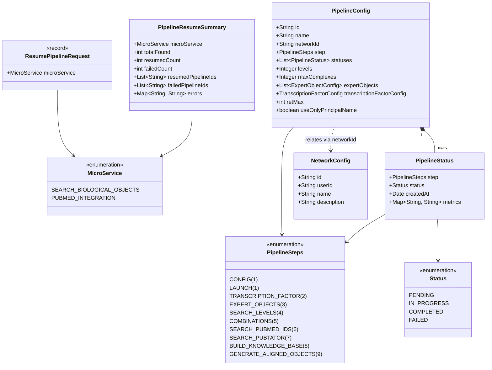
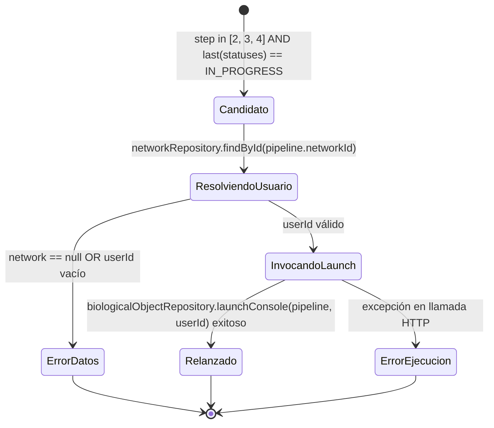
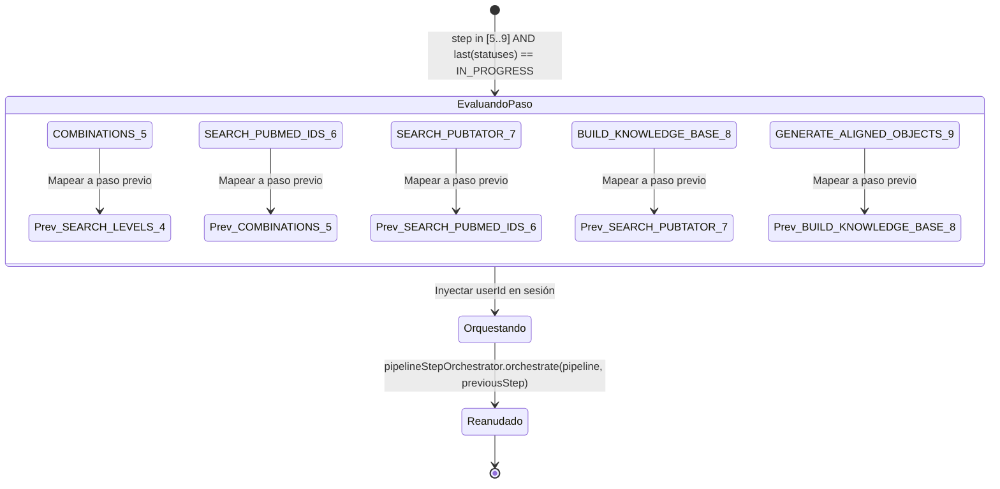

# Data Model: Resume Pipeline (Reanudación Automática de Pipelines)

**Feature**: `001-resume-pipeline`  
**Date**: 2026-10-27  
**Scope**: `config-and-control`  
**Status**: Completed  

---

## 1. Domain Entities & Value Objects

### 1.1 `MicroService` (Domain Enum)
*Package*: `com.biopatternsg.domain.enums`  
Define los microservicios del ecosistema BioPatternsG autorizados para invocar la reanudación autónoma de pipelines.

```java
public enum MicroService {
    SEARCH_BIOLOGICAL_OBJECTS,
    PUBMED_INTEGRATION
}
```

- **Validation Rules**:
  - No puede ser nulo en peticiones entrantes.
  - Valores no reconocidos deben disparar un error `400 Bad Request` o `422 Unprocessable Entity` durante la deserialización JSON.

---

### 1.2 `PipelineResumeSummary` (Domain Model)
*Package*: `com.biopatternsg.domain.models`  
Encapsula el resultado consolidado del caso de uso tras procesar el lote de pipelines pendientes de reanudación.

| Field | Type | Description | Constraints |
|---|---|---|---|
| `microService` | `MicroService` | Microservicio que originó la solicitud de reanudación | Not Null |
| `totalFound` | `int` | Total de pipelines candidatos identificados en base de datos | >= 0 |
| `resumedCount` | `int` | Cantidad de pipelines relanzados/orquestados exitosamente | >= 0 |
| `failedCount` | `int` | Cantidad de pipelines que fallaron durante la reanudación | >= 0 |
| `resumedPipelineIds` | `List<String>` | Identificadores de los pipelines procesados exitosamente | Not Null (lista vacía si total = 0) |
| `failedPipelineIds` | `List<String>` | Identificadores de los pipelines que presentaron error | Not Null (lista vacía si fallas = 0) |
| `errors` | `Map<String, String>` | Detalle de causas de error asociadas a cada pipeline ID fallido | Not Null |

- **Validation & Business Invariants**:
  - `totalFound == resumedCount + failedCount`.
  - La falla individual de un pipeline añade su ID a `failedPipelineIds` y su motivo a `errors`, sin abortar el procesamiento de los demás elementos del lote.

---

### 1.3 `BiologicalObjectRepository` (Outbound Port Extendido)
*Package*: `com.biopatternsg.domain.port.out.repositories`  
Puerto de salida extendido para soportar lanzamiento determinista pasando explícitamente el `userId`:

```java
public interface BiologicalObjectRepository {
    String launch(PipelineConfig pipelineConfig);
    String launchConsole(PipelineConfig pipelineConfig, String userId);
}
```

---

### 1.4 `ResumePipeline` (Inbound Port)
*Package*: `com.biopatternsg.domain.port.in`  
Contrato del caso de uso de reanudación en la capa de aplicación.

```java
public interface ResumePipeline {
    PipelineResumeSummary execute(MicroService microService);
}
```

---

## 2. Infrastructure DTOs

### 2.1 `ResumePipelineRequest` (REST DTO)
*Package*: `com.biopatternsg.infrastructure.dtos`  
Payload de entrada para el endpoint `POST /config-and-control/pipelines/resume`.

```java
public record ResumePipelineRequest(
    @NotNull(message = "microService is required")
    MicroService microService
) {}
```

### 2.2 `PipelineResumeResponse` (REST DTO)
*Package*: `com.biopatternsg.infrastructure.dtos`  
Representación serializable de `PipelineResumeSummary` para la respuesta HTTP 200/202.

```java
public record PipelineResumeResponse(
    MicroService microService,
    int totalFound,
    int resumedCount,
    int failedCount,
    List<String> resumedPipelineIds,
    List<String> failedPipelineIds,
    Map<String, String> errors
) {}
```

---

## 3. Relaciones con Entidades Existentes



---

## 4. Transiciones de Estado y Ciclo de Reanudación

### 4.1 Reanudación en `SEARCH_BIOLOGICAL_OBJECTS` (Pasos 2 al 4)

Los pipelines en pasos 2, 3 o 4 (`TRANSCRIPTION_FACTOR`, `EXPERT_OBJECTS`, `SEARCH_LEVELS`) con su último estado en `IN_PROGRESS` corresponden a ejecuciones biológicas interrumpidas. Su reanudación consiste en relanzar la etapa biológica completa a través de `biologicalObjectRepository.launch(...)`.



### 4.2 Reanudación en `PUBMED_INTEGRATION` (Pasos 5 al 9)

Los pipelines en pasos 5 al 9 con último estado `IN_PROGRESS` se reactivan llamando a `pipelineStepOrchestrator.orchestrate(pipeline, previousStep)` enviando el paso inmediatamente anterior, permitiendo que la máquina de estados retome la secuencia sin reiniciar desde cero.


