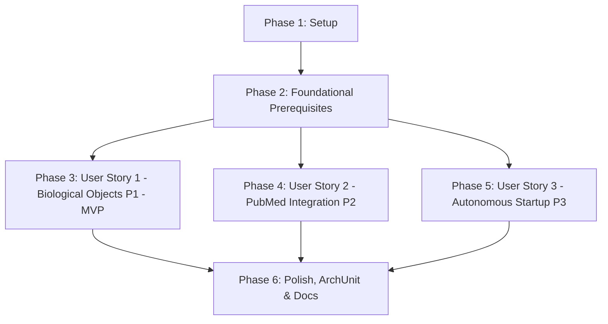

# Tasks: Resume Pipeline (Reanudación Automática de Pipelines)

**Input**: Design documents from `specs/001-resume-pipeline/` (`plan.md`, `spec.md`, `research.md`, `data-model.md`, `contracts/resume-pipeline-api.md`, `quickstart.md`)  
**Prerequisites**: `plan.md` (required), `spec.md` (required for user stories), `research.md`, `data-model.md`, `contracts/resume-pipeline-api.md`, `quickstart.md`, `.specify/memory/constitution.md`  
**Tests**: Unit tests, controller tests, and ArchUnit architecture rule validations are defined across phases per spec and Constitution principles.  
**Organization**: Tasks are grouped by user story to enable independent implementation and testing of each story.

---

## Format: `- [ ] [TaskID] [P?] [Story?] Description with exact file path`

- **[P]**: Can run in parallel (different files, no dependencies on incomplete tasks)
- **[Story]**: Which user story this task belongs to (`[US1]`, `[US2]`, `[US3]`)
- Every task includes exact file paths

## Path Conventions

Multi-repository ecosystem root paths:
- `config-and-control`: `c:\Users\USUARIO\Documents\IdeaProjects\config-and-control\`
- `search-biological-objects`: `c:\Users\USUARIO\Documents\IdeaProjects\search-biological-objects\`
- `pubmed-integration`: `c:\Users\USUARIO\Documents\IdeaProjects\pubmed-integration\`

---

## Phase 1: Setup (Shared Infrastructure & Directories)

**Purpose**: Verificación y preparación de directorios y estructura base en los tres proyectos coordinados.

- [X] T001 Verify and prepare package directories in `c:\Users\USUARIO\Documents\IdeaProjects\config-and-control\src\main\java\com\biopatternsg\domain\enums\`, `c:\Users\USUARIO\Documents\IdeaProjects\config-and-control\src\main\java\com\biopatternsg\domain\models\`, and `c:\Users\USUARIO\Documents\IdeaProjects\config-and-control\src\main\java\com\biopatternsg\infrastructure\adapters\out\session\`
- [X] T002 [P] Verify and prepare package directory `c:\Users\USUARIO\Documents\IdeaProjects\search-biological-objects\src\main\java\com\biopatternsg\infrastructure\boot_functions\` and test directory `c:\Users\USUARIO\Documents\IdeaProjects\search-biological-objects\src\test\java\com\biopatternsg\infrastructure\boot_functions\`
- [X] T003 [P] Verify and prepare package directory `c:\Users\USUARIO\Documents\IdeaProjects\pubmed-integration\src\main\java\com\biopatternsg\infrastructure\boot_functions\` and test directory `c:\Users\USUARIO\Documents\IdeaProjects\pubmed-integration\src\test\java\com\biopatternsg\infrastructure\boot_functions\`

---

## Phase 2: Foundational (Blocking Prerequisites)

**Purpose**: Prerrequisitos bloqueantes de dominio, puertos, DTOs, persistencia y seguridad que DEBEN completarse antes de implementar las historias de usuario.

**⚠️ CRITICAL**: Ninguna historia de usuario puede comenzar antes de culminar esta fase.

- [X] T004 [P] Create domain enum `MicroService` with values `SEARCH_BIOLOGICAL_OBJECTS` and `PUBMED_INTEGRATION` in `c:\Users\USUARIO\Documents\IdeaProjects\config-and-control\src\main\java\com\biopatternsg\domain\enums\MicroService.java` (Constraints: "No puede ser nulo en peticiones entrantes. Valores no reconocidos deben disparar un error 400 Bad Request o 422 Unprocessable Entity durante la deserialización JSON")
- [X] T005 [P] Create domain model `PipelineResumeSummary` in `c:\Users\USUARIO\Documents\IdeaProjects\config-and-control\src\main\java\com\biopatternsg\domain\models\PipelineResumeSummary.java` (Constraints: `microService` Not Null, `totalFound` >= 0, `resumedCount` >= 0, `failedCount` >= 0, `resumedPipelineIds` Not Null, `failedPipelineIds` Not Null, `errors` Not Null, and invariant `totalFound == resumedCount + failedCount`)
- [X] T006 [P] Create inbound port interface `ResumePipeline` with method `PipelineResumeSummary execute(MicroService microService)` in `c:\Users\USUARIO\Documents\IdeaProjects\config-and-control\src\main\java\com\biopatternsg\domain\port\in\ResumePipeline.java`
- [X] T007 [P] Update outbound port interface `BiologicalObjectRepository` with method `String launchConsole(PipelineConfig pipelineConfig, String userId)` in `c:\Users\USUARIO\Documents\IdeaProjects\config-and-control\src\main\java\com\biopatternsg\domain\port\out\repositories\BiologicalObjectRepository.java`
- [X] T008 [P] Implement `launchConsole(PipelineConfig pipelineConfig, String userId)` in `BiologicalObjectAdapter` in `c:\Users\USUARIO\Documents\IdeaProjects\config-and-control\src\main\java\com\biopatternsg\infrastructure\adapters\out\repositories\BiologicalObjectAdapter.java` calling `biologicalObjectHttpClient.launch(pipelineBiologicalObject, userId)` with `@Retry` and delegating `launch(pipelineConfig)` to `launchConsole` with `sessionUtil.getUserId()`
- [X] T009 [P] Create request DTO record `ResumePipelineRequest` in `c:\Users\USUARIO\Documents\IdeaProjects\config-and-control\src\main\java\com\biopatternsg\infrastructure\dtos\ResumePipelineRequest.java` (Constraint: `@NotNull(message = "microService is required") MicroService microService`)
- [X] T010 [P] Create response DTO record `PipelineResumeResponse` in `c:\Users\USUARIO\Documents\IdeaProjects\config-and-control\src\main\java\com\biopatternsg\infrastructure\dtos\PipelineResumeResponse.java` and add static mapping method `toResponse(PipelineResumeSummary summary)` in `c:\Users\USUARIO\Documents\IdeaProjects\config-and-control\src\main\java\com\biopatternsg\infrastructure\adapters\mappers\PipelineMapper.java`
- [X] T011 Add repository query method `findInProgressBySteps(List<PipelineSteps> steps)` in `c:\Users\USUARIO\Documents\IdeaProjects\config-and-control\src\main\java\com\biopatternsg\infrastructure\mongo_db\repositories\PipelineRepositoryDB.java` using Panache Mongo query with `$expr` checking last element of `statuses.status` equals `IN_PROGRESS` and `step in :steps`
- [X] T012 Add method `List<PipelineConfig> findInProgressBySteps(List<PipelineSteps> steps)` to `PipelineRepository` in `c:\Users\USUARIO\Documents\IdeaProjects\config-and-control\src\main\java\com\biopatternsg\domain\port\out\repositories\PipelineRepository.java` and implement it in `c:\Users\USUARIO\Documents\IdeaProjects\config-and-control\src\main\java\com\biopatternsg\infrastructure\adapters\out\repositories\PipelineRepositoryAdapter.java`
- [X] T013 Update `NetworkRepositoryAdapter.findById(String id)` in `c:\Users\USUARIO\Documents\IdeaProjects\config-and-control\src\main\java\com\biopatternsg\infrastructure\adapters\out\repositories\NetworkRepositoryAdapter.java` to support unauthenticated fallback lookup by `ObjectId` via `networkRepositoryDB.findById(new ObjectId(id))` when session context is null
- [X] T014 Update `ContextInterceptor` in `c:\Users\USUARIO\Documents\IdeaProjects\config-and-control\src\main\java\com\biopatternsg\infrastructure\config\interceptors\ContextInterceptor.java` to bypass mandatory `x-user-id` header validation for path `config-and-control/pipelines/resume`

**Checkpoint**: Foundation ready - Inbound/Outbound ports, base models, persistence queries, DTOs, and session infrastructure are in place. User story implementation can now begin.

---

## Phase 3: User Story 1 - Reanudación Automática en Etapa de Objetos Biológicos (Priority: P1) 🎯 MVP

**Goal**: Permitir la reanudación autónoma de pipelines estancados en los pasos 2, 3 o 4 (`TRANSCRIPTION_FACTOR`, `EXPERT_OBJECTS`, `SEARCH_LEVELS`) con último estado `IN_PROGRESS` para el microservicio `SEARCH_BIOLOGICAL_OBJECTS`, resolviendo `userId` desde la red y relanzando la computación biológica vía `biologicalObjectRepository.launchConsole(pipeline, userId)`.

**Independent Test**: Invocar `POST /config-and-control/pipelines/resume` con `{"microService": "SEARCH_BIOLOGICAL_OBJECTS"}` teniendo en MongoDB pipelines en pasos 2, 3 o 4 en `IN_PROGRESS`, y verificar que el caso de uso recupera la entidad `Network`, invoca `biologicalObjectRepository.launchConsole(pipeline, userId)`, y devuelve un `PipelineResumeResponse` con `resumedCount > 0` y `failedCount == 0`.

### Tests for User Story 1

- [X] T015 [P] [US1] Unit test suite for `ResumePipelineUseCase` biological objects branch in `c:\Users\USUARIO\Documents\IdeaProjects\config-and-control\src\test\java\unit\usecase\ResumePipelineUseCaseTest.java` verifying filtering of steps 2, 3, and 4 in `IN_PROGRESS`, resolution of `userId` from `NetworkRepository`, call to `biologicalObjectRepository.launchConsole(pipeline, userId)`, and per-item resilience (EC-002, EC-004)

### Implementation for User Story 1

- [X] T016 [US1] Implement `ResumePipelineUseCase` in `c:\Users\USUARIO\Documents\IdeaProjects\config-and-control\src\main\java\com\biopatternsg\application\usecase\ResumePipelineUseCase.java` handling `MicroService.SEARCH_BIOLOGICAL_OBJECTS`: query pipelines with `pipelineRepository.findInProgressBySteps(List.of(TRANSCRIPTION_FACTOR, EXPERT_OBJECTS, SEARCH_LEVELS))`, resolve `userId` from `networkRepository.findById(pipeline.getNetworkId())`, and invoke `biologicalObjectRepository.launchConsole(pipeline, userId)` with try-catch per pipeline recording failures without aborting the batch
- [X] T017 [US1] Expose REST endpoint `POST /config-and-control/pipelines/resume` in `c:\Users\USUARIO\Documents\IdeaProjects\config-and-control\src\main\java\com\biopatternsg\infrastructure\adapters\in\restcontrollers\PipelineController.java` receiving `ResumePipelineRequest`, delegating to `ResumePipeline.execute(request.microService())`, and returning `PipelineResumeResponse` mapped via `PipelineMapper.toResponse(...)`
- [X] T018 [US1] Unit tests for `PipelineController.resume` endpoint in `c:\Users\USUARIO\Documents\IdeaProjects\config-and-control\src\test\java\unit\restcontrollers\PipelineControllerTest.java` validating HTTP 200 response with `PipelineResumeResponse` and HTTP 400 for null/invalid request body

**Checkpoint**: At this point, User Story 1 is fully functional and independently testable. The MVP delivers automated recovery for the biological objects stage.

---

## Phase 4: User Story 2 - Reanudación Automática en Etapa de Integración PubMed (Priority: P2)

**Goal**: Permitir la reanudación autónoma de pipelines estancados en los pasos 5 al 9 (`COMBINATIONS`, `SEARCH_PUBMED_IDS`, `SEARCH_PUBTATOR`, `BUILD_KNOWLEDGE_BASE`, `GENERATE_ALIGNED_OBJECTS`) con último estado `IN_PROGRESS` para el microservicio `PUBMED_INTEGRATION`, mapeando al paso previo inmediato e invocando `pipelineStepOrchestrator.orchestrate(pipeline, previousStep)`.

**Independent Test**: Invocar `POST /config-and-control/pipelines/resume` con `{"microService": "PUBMED_INTEGRATION"}` teniendo en MongoDB pipelines en pasos 5 al 9 en `IN_PROGRESS`, y verificar que el caso de uso recupera el `userId`, e invoca `pipelineStepOrchestrator.orchestrate` con el predecesor exacto (`COMBINATIONS` -> `SEARCH_LEVELS`, `SEARCH_PUBMED_IDS` -> `COMBINATIONS`, `SEARCH_PUBTATOR` -> `SEARCH_PUBMED_IDS`, `BUILD_KNOWLEDGE_BASE` -> `SEARCH_PUBTATOR`, `GENERATE_ALIGNED_OBJECTS` -> `BUILD_KNOWLEDGE_BASE`).

### Tests for User Story 2

- [X] T019 [P] [US2] Unit test suite in `c:\Users\USUARIO\Documents\IdeaProjects\config-and-control\src\test\java\unit\usecase\ResumePipelineUseCaseTest.java` for `MicroService.PUBMED_INTEGRATION` covering steps 5 to 9 mapping to previous steps (`COMBINATIONS` -> `SEARCH_LEVELS`, `SEARCH_PUBMED_IDS` -> `COMBINATIONS`, `SEARCH_PUBTATOR` -> `SEARCH_PUBMED_IDS`, `BUILD_KNOWLEDGE_BASE` -> `SEARCH_PUBTATOR`, `GENERATE_ALIGNED_OBJECTS` -> `BUILD_KNOWLEDGE_BASE`), and invocation of `pipelineStepOrchestrator.orchestrate(pipeline, previousStep)`

### Implementation for User Story 2

- [X] T020 [US2] Extend `ResumePipelineUseCase` in `c:\Users\USUARIO\Documents\IdeaProjects\config-and-control\src\main\java\com\biopatternsg\application\usecase\ResumePipelineUseCase.java` to implement `MicroService.PUBMED_INTEGRATION`: query pipelines with `pipelineRepository.findInProgressBySteps(List.of(COMBINATIONS, SEARCH_PUBMED_IDS, SEARCH_PUBTATOR, BUILD_KNOWLEDGE_BASE, GENERATE_ALIGNED_OBJECTS))`, resolve `userId` from `networkRepository.findById(pipeline.getNetworkId())`, map `pipeline.getStep()` to predecessor `previousStep`, and invoke `pipelineStepOrchestrator.orchestrate(pipeline, previousStep)` with per-item resilience

**Checkpoint**: At this point, User Stories 1 AND 2 are both functional and testable independently.

---

## Phase 5: User Story 3 - Inicialización Autónoma al Arranque de los Microservicios (Priority: P3)

**Goal**: Configurar en los microservicios `search-biological-objects` y `pubmed-integration` el bean de ciclo de vida `AppLifecycleBean` escuchando `StartupEvent` de Quarkus e invocando el endpoint de reanudación de `config-and-control` con tolerancia a fallos en caso de indisponibilidad temporal.

**Independent Test**: Ejecutar las pruebas unitarias de `AppLifecycleBeanTest` en cada uno de los microservicios (`search-biological-objects` y `pubmed-integration`) verificando que al dispararse el `StartupEvent` se emite la petición HTTP hacia `config-and-control` con el payload respectivo y que si ocurre una excepción de red, esta es capturada y registrada sin abortar el arranque de la aplicación.

### Tests for User Story 3

- [X] T021 [P] [US3] Unit test for `AppLifecycleBean` in `c:\Users\USUARIO\Documents\IdeaProjects\search-biological-objects\src\test\java\com\biopatternsg\infrastructure\boot_functions\AppLifecycleBeanTest.java` verifying startup dispatch and non-blocking failure tolerance
- [X] T022 [P] [US3] Unit test for `AppLifecycleBean` in `c:\Users\USUARIO\Documents\IdeaProjects\pubmed-integration\src\test\java\com\biopatternsg\infrastructure\boot_functions\AppLifecycleBeanTest.java` verifying startup dispatch and non-blocking failure tolerance

### Implementation for User Story 3

- [X] T023 [P] [US3] Create DTO record `ResumePipelineRequest` with `microService` property in `c:\Users\USUARIO\Documents\IdeaProjects\search-biological-objects\src\main\java\com\biopatternsg\infrastructure\dtos\ResumePipelineRequest.java`
- [X] T024 [P] [US3] Add `@POST @Path("/config-and-control/pipelines/resume") Response resumePipelines(ResumePipelineRequest request)` to `c:\Users\USUARIO\Documents\IdeaProjects\search-biological-objects\src\main\java\com\biopatternsg\infrastructure\clients\internal_clients\ConfigAndControlHttpClient.java`
- [X] T025 [US3] Create `AppLifecycleBean` in `c:\Users\USUARIO\Documents\IdeaProjects\search-biological-objects\src\main\java\com\biopatternsg\infrastructure\boot_functions\AppLifecycleBean.java` observing `@Observes StartupEvent` and invoking `configAndControlHttpClient.resumePipelines(new ResumePipelineRequest("SEARCH_BIOLOGICAL_OBJECTS"))` with defensive try-catch logging errors without aborting application startup
- [X] T026 [P] [US3] Create DTO record `ResumePipelineRequest` with `microService` property in `c:\Users\USUARIO\Documents\IdeaProjects\pubmed-integration\src\main\java\com\biopatternsg\infrastructure\adapters\dtos\ResumePipelineRequest.java`
- [X] T027 [P] [US3] Add `@POST @Path("config-and-control/pipelines/resume") Response resumePipelines(ResumePipelineRequest request)` to `c:\Users\USUARIO\Documents\IdeaProjects\pubmed-integration\src\main\java\com\biopatternsg\infrastructure\clients\internal\ConfigAndControlHttpClient.java`
- [X] T028 [US3] Create `AppLifecycleBean` in `c:\Users\USUARIO\Documents\IdeaProjects\pubmed-integration\src\main\java\com\biopatternsg\infrastructure\boot_functions\AppLifecycleBean.java` observing `@Observes StartupEvent` and invoking `configAndControlHttpClient.resumePipelines(new ResumePipelineRequest("PUBMED_INTEGRATION"))` with defensive try-catch logging errors without aborting application startup

**Checkpoint**: All three user stories are now independently functional and complete. Microservices autonomously trigger resumption on startup.

---

## Phase 6: Polish & Cross-Cutting Concerns

**Purpose**: Documentación sincrónica mandatoria por la Constitución, verificación de reglas de capas ArchUnit y validación de escenarios de prueba.

- [X] T029 [P] Create Use Case documentation with Mermaid sequence diagram, execution flow, inbound/outbound ports, and domain error catalog in `c:\Users\USUARIO\Documents\IdeaProjects\config-and-control\.agents\use_cases\ResumePipelineUseCase.md` per Constitution Principle IV
- [X] T030 [P] Register `ResumePipelineUseCase` in the use cases index table of `c:\Users\USUARIO\Documents\IdeaProjects\config-and-control\.agents\architecture.md` per Constitution Principle IV
- [X] T031 Run and verify ArchUnit architectural constraints and naming convention tests via `ArchitectureLayerTest` in `c:\Users\USUARIO\Documents\IdeaProjects\config-and-control\src\test\java\archtest\ArchitectureLayerTest.java` per Constitution Principle VI (extracting domain interface `com.biopatternsg.domain.services.PipelineService`, implementing `com.biopatternsg.application.services.PipelineServiceImpl`, updating references in adapters, use cases and tests, and preserving intact the original `ArchitectureLayerTest.layerApplicationTest()` rule)
- [X] T032 Validate end-to-end resume pipeline flow scenarios against acceptance criteria in `c:\Users\USUARIO\Documents\IdeaProjects\config-and-control\specs\001-resume-pipeline\quickstart.md`

---

## Dependencies & Execution Order

### Phase Dependencies

- **Setup (Phase 1)**: No dependencies - executes immediately.
- **Foundational (Phase 2)**: Depends on Phase 1 completion - **BLOCKS** all user stories.
- **User Story 1 (Phase 3)**: Depends on Phase 2 completion. Delivers the MVP increment.
- **User Story 2 (Phase 4)**: Depends on Phase 2 completion. Can proceed in parallel with US1 or sequentially after US1.
- **User Story 3 (Phase 5)**: Depends on Phase 2 completion and the endpoint contract defined in `contracts/resume-pipeline-api.md`. Can proceed in parallel across both client repositories.
- **Polish (Phase 6)**: Depends on completion of User Stories 1, 2, and 3.

### User Story Dependencies

- **US1 (P1)**: Independent after Foundational (Phase 2).
- **US2 (P2)**: Independent after Foundational (Phase 2) (shares `ResumePipelineUseCase` file with US1, so if executed by a single developer, US2 extends the class established in US1).
- **US3 (P3)**: Independent after Foundational (Phase 2) and endpoint contract specification. Runs in external repositories (`search-biological-objects` and `pubmed-integration`).

### Within Each User Story

1. Unit tests written and verified before or alongside implementation.
2. Models, ports and DTOs before use case logic.
3. Use case implementation before REST controller exposure.
4. Per-pipeline failure handling (EC-002, EC-004) before final validation.

---

## Parallel Opportunities

### Parallel Opportunities in Phase 1 (Setup)
- `T002` (in `search-biological-objects`) and `T003` (in `pubmed-integration`) can run in parallel with `T001`.

### Parallel Opportunities in Phase 2 (Foundational)
- `T004` (Enum `MicroService`), `T005` (Model `PipelineResumeSummary`), `T006` (Port `ResumePipeline`), `T007` (Method `BiologicalObjectRepository.launchConsole`), `T008` (Implementation in `BiologicalObjectAdapter`), `T009` (DTO `ResumePipelineRequest`), and `T010` (DTO `PipelineResumeResponse`) can all be implemented in parallel as they reside in distinct files with zero cross-dependencies during creation.

### Parallel Opportunities in Phase 3 (User Story 1)
- `T015` (Unit tests for US1) can be authored in parallel with DTO mapping.

### Parallel Opportunities in Phase 5 (User Story 3)
- `search-biological-objects` tasks (`T021`, `T022`, `T023`, `T024`) and `pubmed-integration` tasks (`T025`, `T026`, `T027`, `T028`) can be executed completely in parallel as they belong to entirely separate Git repositories and codebases.

### Parallel Opportunities in Phase 6 (Polish)
- `T029` (Markdown documentation `ResumePipelineUseCase.md`) and `T030` (Index registration in `architecture.md`) can be prepared in parallel.

---

## Implementation Strategy (MVP First, Incremental Delivery)

### MVP First (User Story 1 Only)

1. **Step 1**: Complete Phase 1: Setup (`T001` - `T003`).
2. **Step 2**: Complete Phase 2: Foundational Prerequisites (`T004` - `T014`).
3. **Step 3**: Implement Phase 3: User Story 1 (`T015` - `T018`).
4. **Step 4 - Validate MVP**: Run unit tests and execute `curl` testing for `SEARCH_BIOLOGICAL_OBJECTS` per `quickstart.md` Scenario 1.
5. **Outcome**: The core biological recovery capability is operational and testable.

### Incremental Delivery

1. **Increment 1 (MVP)**: Phase 1 + Phase 2 + Phase 3 -> Reanudación para `SEARCH_BIOLOGICAL_OBJECTS`.
2. **Increment 2**: Phase 4 -> Reanudación para `PUBMED_INTEGRATION` (pasos 5 al 9 reactivados).
3. **Increment 3**: Phase 5 -> Inicialización autónoma desatendida en `search-biological-objects` y `pubmed-integration`.
4. **Increment 4 (Quality & Documentation)**: Phase 6 -> Documentación constitucional `.agents/use_cases/ResumePipelineUseCase.md`, actualización de `.agents/architecture.md`, y verificación con `ArchitectureLayerTest`.

---

## Notes

- All tasks strictly follow the `- [ ] TXXX [P?] [US?] Description with exact file path` specification.
- Hexagonal architecture layer isolation is strictly preserved through `BiologicalObjectRepository.launchConsole(pipeline, userId)` in `domain.port.out.repositories`, passing `userId` explicitly and avoiding session thread-state dependencies in `ResumePipelineUseCase`.
- Constraints from `data-model.md` and acceptance criteria from `spec.md` are quoted verbatim in task definitions.
