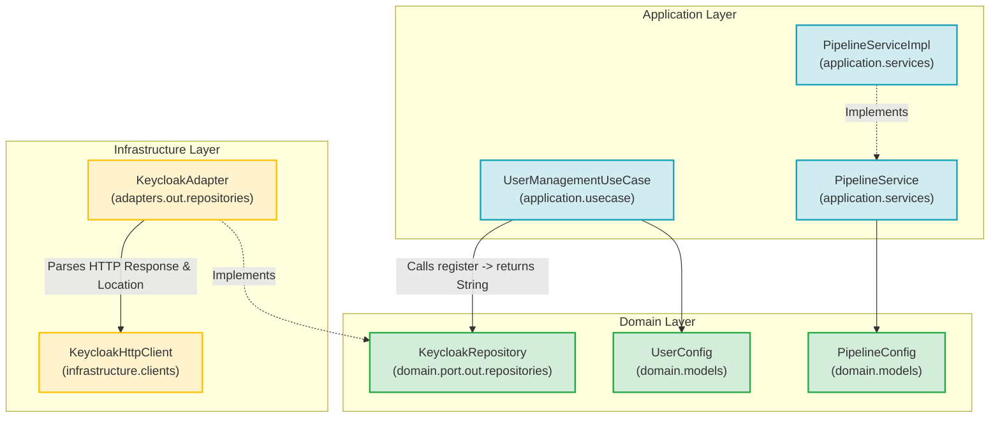

# Data Model & Architectural Boundaries: Domain Layer Purity and Framework Decoupling

## Overview

This document specifies the domain models, value objects, and boundary interfaces impacted by the decoupling of external framework dependencies and the elimination of the domain services package.

---

## 1. Core Domain Entities & Models

### 1.1. `UserConfig` (`com.biopatternsg.domain.models.UserConfig`)
- **Package**: `com.biopatternsg.domain.models`
- **Role**: Represents user configuration, authentication attributes, and profile data in the domain layer.
- **Key Attributes**:
  - `id`: `String` (Internal system identifier)
  - `username`: `String` (Email / Username)
  - `firstName`: `String` (Given name)
  - `lastName`: `String` (Family name)
  - `identityProviderId`: `String` (Assigned external identifier from Keycloak OIDC)
- **Lifecycle & Boundaries**:
  - `UserManagementUseCase` receives `UserConfig` without `identityProviderId`.
  - Invokes `KeycloakRepository.register(userConfig)`.
  - Attaches returned `identityProviderId` to `UserConfig`.
  - Persists `UserConfig` to MongoDB via `UserRepository.create(userConfig)`.

### 1.2. `PipelineConfig` & `PipelineStatus` (`com.biopatternsg.domain.models.*`)
- **Package**: `com.biopatternsg.domain.models`
- **Role**: Aggregate root representing biological pipeline execution configuration, current step, and status history.
- **Attributes**:
  - `id`: `String` (Pipeline execution ID)
  - `networkId`: `String` (Associated network ID)
  - `step`: `PipelineSteps` (Current active step)
  - `statuses`: `List<PipelineStatus>` (History of step execution states and metrics)

---

## 2. Port & Service Contracts

### 2.1. `KeycloakRepository` (Domain Outbound Port)
- **Package**: `com.biopatternsg.domain.port.out.repositories`
- **Signature Change**:
  ```java
  // BEFORE (Violates Hexagonal purity):
  jakarta.ws.rs.core.Response register(UserConfig newUser);

  // AFTER (Pure Domain Contract):
  String register(UserConfig newUser);
  ```
- **Constraints**:
  - Zero imports from `jakarta.ws.rs.*` or any external transport library.
  - Return value is the generated `identityProviderId` (String).
  - Throws `KeycloakServiceException` (or domain exceptions) on failures.

### 2.2. `PipelineService` (Application Service Interface)
- **Package Relocation**:
  ```java
  // BEFORE (Mismatched / Forbidden Package):
  package com.biopatternsg.domain.services;
  public interface PipelineService { ... }

  // AFTER (Compliant Application Service):
  package com.biopatternsg.application.services;
  public interface PipelineService { ... }
  ```
- **Methods**:
  - `void updateStep(String pipelineId, PipelineSteps step, Status status)`
  - `void updateStep(String pipelineId, PipelineSteps step, Status status, Map<String, String> metrics)`
- **Constraints**:
  - Package `com.biopatternsg.domain.services` is completely removed from the filesystem.

---

## 3. Layer Dependency Diagram


