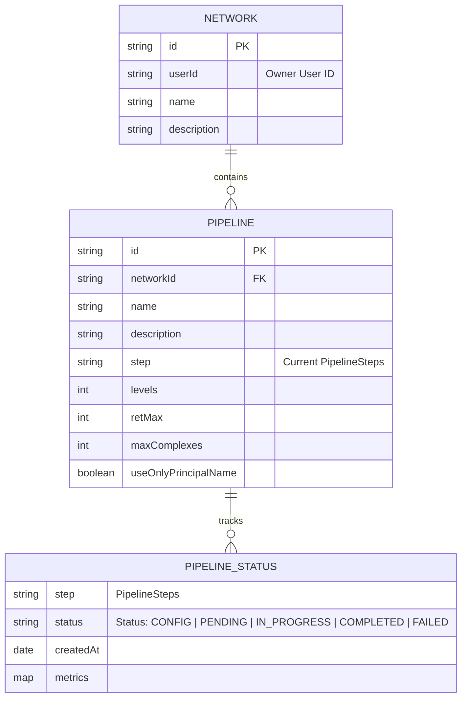
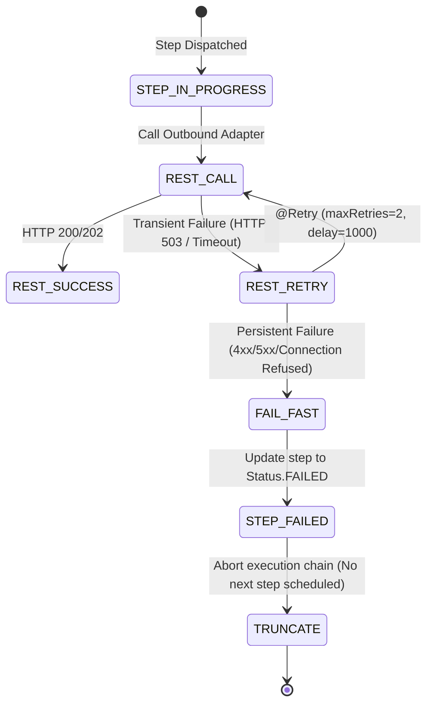
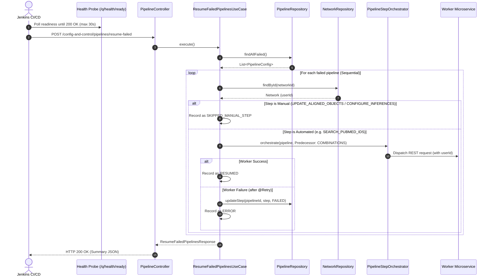

# Data Model & Domain Design: Automated Pipeline Resumption and Fail-Fast Truncation

**Feature Branch**: `002-resume-failed-pipelines-on-deploy`  
**Date**: 2026-10-20  
**Spec Reference**: [spec.md](./spec.md)

---

## 1. Domain Entities & Aggregate Roots

### 1.1 `PipelineConfig` (Domain Aggregate Root)
- **Package**: `com.biopatternsg.domain.models`
- **Fields**:
  - `id`: `String` (UUID / Mongo ObjectId string)
  - `name`: `String`
  - `networkId`: `String` (Reference to parent `NetworkCollection`)
  - `step`: `PipelineSteps` (Last active step in sequence)
  - `statuses`: `List<PipelineStatus>` (History of transitions per step)
- **Key Business Logic**:
  - `isFailed()`: Returns true if the most recent entry in `statuses` has `status == Status.FAILED`.
  - `getFailedStep()`: Returns the `PipelineSteps` value corresponding to the latest `FAILED` status entry.

### 1.2 `NetworkCollection` (Multi-Tenant Context Resolver)
- **Package**: `com.biopatternsg.infrastructure.mongo_db.collections`
- **Fields**:
  - `id`: `ObjectId`
  - `userId`: `String` (Keycloak User UUID)
  - `name`: `String`
- **Role in Resumption**:
  - When `ResumeFailedPipelinesUseCase` processes a pipeline, it queries `NetworkRepository.findById(pipeline.getNetworkId())` to resolve the `userId`. This `userId` is dynamically bound to `SessionUtil` context for all downstream worker calls.

---

## 2. Resumption Response DTOs

### 2.1 `ResumeFailedPipelinesResponse`
- **Package**: `com.biopatternsg.infrastructure.dtos`
- **Purpose**: Returned by `POST /config-and-control/pipelines/resume-failed` to Jenkins and system operators.
- **Fields**:

| Field | Type | Description |
|---|---|---|
| `totalFailed` | `int` | Total count of pipelines discovered with `FAILED` status |
| `resumed` | `int` | Count of pipelines successfully re-dispatched to worker services |
| `skipped` | `int` | Count of pipelines skipped (e.g. paused at manual steps) |
| `errors` | `int` | Count of pipelines whose resumption threw an unhandled exception |
| `details` | `List<PipelineResumeDetail>` | Itemized detail for each evaluated pipeline |

### 2.2 `PipelineResumeDetail`
- **Package**: `com.biopatternsg.infrastructure.dtos`
- **Fields**:

| Field | Type | Description |
|---|---|---|
| `pipelineId` | `String` | Target pipeline identifier |
| `networkId` | `String` | Associated network identifier |
| `userId` | `String` | Resolved owner user identifier |
| `failedStep` | `PipelineSteps` | The step where failure occurred |
| `resumedFromStep` | `PipelineSteps` | The predecessor step passed to `PipelineStepOrchestrator` (or `null` if initial) |
| `resultStatus` | `String` | `"RESUMED"`, `"SKIPPED_MANUAL_STEP"`, `"ERROR"` |
| `message` | `String` | Descriptive status or exception message |

---

## 3. Step Predecessor & Resumption Mapping Table

The pipeline lifecycle follows a deterministic sequence of 11 steps. For any automated step marked `FAILED`, the orchestrator advances to the failed step by receiving its immediately preceding step:

| Failed Step (`targetStep`) | Step Type | Predecessor Step (`completedStep`) Sent to Orchestrator | Action Triggered by Orchestrator |
|---|---|---|---|
| `LAUNCH` | Automated | *N/A (Direct Dispatch)* | `biologicalObjectRepository.launch(pipeline)` |
| `SEARCH_LEVELS` | Automated | *N/A (Direct Dispatch)* | `biologicalObjectRepository.launch(pipeline)` |
| `COMBINATIONS` | Automated | `SEARCH_LEVELS` | `triggerPubmedIntegration.executeBuildsPairs(pipeline)` |
| `SEARCH_PUBMED_IDS` | Automated | `COMBINATIONS` | `triggerPubmedIntegration.executeSearchPubmedIds(pipeline)` |
| `SEARCH_PUBTATOR` | Automated | `SEARCH_PUBMED_IDS` | `triggerPubmedIntegration.executeSearchPubtator(pipeline)` |
| `BUILD_KNOWLEDGE_BASE` | Automated | `SEARCH_PUBTATOR` | `triggerPubmedIntegration.executeBuildKnowledgeBase(pipeline)` |
| `GENERATE_ALIGNED_OBJECTS` | Automated | `BUILD_KNOWLEDGE_BASE` | `triggerPubmedIntegration.executeGenerateAlignedObjects(pipeline)` |
| `UPDATE_ALIGNED_OBJECTS` | **Manual** | *Do not re-dispatch* | Resets status to `PENDING` waiting for user validation in UI |
| `CONFIGURE_INFERENCES` | **Manual** | *Do not re-dispatch* | Resets status to `PENDING` waiting for user parameters in UI |
| `FIND_ROLES` | Automated | `CONFIGURE_INFERENCES` | `triggerInferences.executeFindRoles(pipeline)` |
| `UPDATE_BIOLOGICAL_OBJECTS` | Automated | `FIND_ROLES` | Updates biological objects persistence |

---

## 4. State Transition Diagrams

### 4.1 Fail-Fast Error Truncation Transition
When a downstream microservice request fails:

### 4.2 Post-Deployment Resumption Transition
When `config-and-control` restarts and Jenkins triggers `resumeFailedPipelines`:

