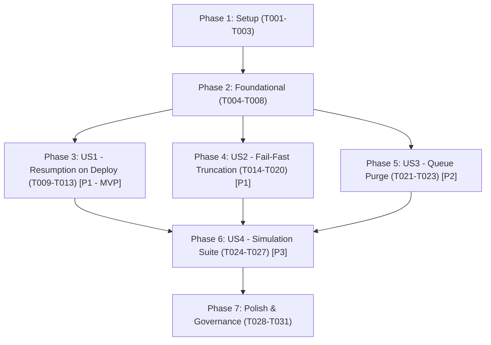

# Tasks: Automated Pipeline Resumption on Deployment and Fail-Fast Error Truncation

**Input**: Design documents from `specs/002-resume-failed-pipelines-on-deploy/` (`plan.md`, `spec.md`, `research.md`, `data-model.md`, `contracts/`, `quickstart.md`)  
**Prerequisites**: `plan.md` complete, `spec.md` complete (8 clarified decisions integrated), `data-model.md` and `contracts/` available.  
**Tests**: Explicit testing tasks included per user requirements (deployment simulation across all 7 automated steps, unit tests in `unit.*` for ArchUnit compliance).  
**Organization**: Tasks grouped by user story (US1 to US4) following priority order, preceded by Setup and Foundational phases and concluded with Polish & Governance.

---

## Format: `- [ ] [TaskID] [P?] [Story?] Description with exact file path`

- **[P]**: Can run in parallel (different files, no blocking dependencies)
- **[Story]**: Belongs to specific user story (`[US1]`, `[US2]`, `[US3]`, `[US4]`)
- **[EXT-WS]**: Touches repository outside active workspace (`c:\Users\USUARIO\Documents\IdeaProjects\search-biological-objects`) requiring elevated user permission

---

## Phase 1: Setup (Shared Infrastructure & Dependencies)

**Purpose**: Initialize project dependencies and script testing harnesses across microservices.

- [x] T001 [P] Add dependency `io.quarkus:quarkus-smallrye-health` to `c:\Users\USUARIO\Documents\IdeaProjects\config-and-control\pom.xml` and verify `./mvnw clean compile -DskipTests && ./mvnw test-compile` succeeds
- [x] T002 [P] Add dependency `io.quarkus:quarkus-smallrye-fault-tolerance` to `c:\Users\USUARIO\Documents\IdeaProjects\pubmed-integration\pom.xml` and verify `./mvnw clean compile -DskipTests && ./mvnw test-compile` succeeds
- [x] T003 [P] Create shell syntax verification script `c:\Users\USUARIO\Documents\IdeaProjects\config-and-control\src\test\resources\scripts\validate-deployment-scripts.sh` to validate Jenkinsfile shell snippets using `sh -n`

---

## Phase 2: Foundational (Blocking Prerequisites)

**Purpose**: Core domain contracts, models, repository ports, and security interceptor updates that MUST be complete before ANY user story can be implemented.

**⚠️ CRITICAL**: No user story implementation can begin until this phase is complete.

- [x] T004 [P] Create domain result models `ResumeFailedPipelinesResponse.java` and `PipelineResumeDetail.java` in `c:\Users\USUARIO\Documents\IdeaProjects\config-and-control\src\main\java\com\biopatternsg\domain\models\ResumeFailedPipelinesResponse.java` containing `totalFailed`, `resumed`, `skipped`, `errors`, and `List<PipelineResumeDetail>` per `data-model.md`
- [x] T005 [P] Create Inbound Port interface `ResumeFailedPipelines.java` in `c:\Users\USUARIO\Documents\IdeaProjects\config-and-control\src\main\java\com\biopatternsg\domain\port\in\ResumeFailedPipelines.java` with method `ResumeFailedPipelinesResponse execute()`
- [x] T006 Add `List<PipelineConfig> findAllFailed()` method to Outbound Port `PipelineRepository.java` in `c:\Users\USUARIO\Documents\IdeaProjects\config-and-control\src\main\java\com\biopatternsg\domain\port\out\repositories\PipelineRepository.java`
- [x] T007 Implement `findAllFailed()` in `c:\Users\USUARIO\Documents\IdeaProjects\config-and-control\src\main\java\com\biopatternsg\infrastructure\adapters\out\repositories\PipelineRepositoryAdapter.java` querying `PipelineCollection` for records where latest entry in `statuses.status` is `Status.FAILED`
- [x] T008 Update `ContextInterceptor.java` in `c:\Users\USUARIO\Documents\IdeaProjects\config-and-control\src\main\java\com\biopatternsg\infrastructure\config\interceptors\ContextInterceptor.java` to bypass mandatory `x-user-id` header validation when request URI contains `config-and-control/pipelines/resume-failed` or when request header `x-system-call: true` is present

**Checkpoint**: Foundation ready - Inbound/Outbound ports and interceptor exemption compiled; user story implementation can begin.

---

## Phase 3: User Story 1 - Automatic Pipeline Resumption on Deployment (Priority: P1) 🎯 MVP

**Goal**: Automatically detect all pipelines in `FAILED` status upon deployment, resolve tenant `userId` from parent `NetworkCollection`, determine predecessor step, and re-dispatch execution via `PipelineStepOrchestrator` without re-running completed steps.

**Independent Test**: Mark one or more pipelines as `FAILED` at step `SEARCH_PUBMED_IDS` in MongoDB, invoke `POST /config-and-control/pipelines/resume-failed`, verify pipeline transitions to `IN_PROGRESS` at `SEARCH_PUBMED_IDS`, and confirm dispatch to worker with resolved `userId`.

### Tests for User Story 1

- [x] T009 [P] [US1] Create unit test `ResumeFailedPipelinesUseCaseTest.java` in `c:\Users\USUARIO\Documents\IdeaProjects\config-and-control\src\test\java\unit\usecase\ResumeFailedPipelinesUseCaseTest.java` (in package `unit.*` for ArchUnit compliance) testing:
  - Step predecessor calculation for intermediate automated steps (`SEARCH_PUBMED_IDS` → `COMBINATIONS`)
  - Initial step failure re-launch (`SEARCH_LEVELS` / `LAUNCH` → `biologicalObjectRepository.launch`)
  - `FIND_ROLES` failure re-dispatch (`FIND_ROLES` → `CONFIGURE_INFERENCES` → `triggerInferences.executeFindRoles`)
  - Dynamic `userId` resolution from mock `NetworkRepository`
  - Exemption of manual steps (`UPDATE_ALIGNED_OBJECTS`, `CONFIGURE_INFERENCES`) recording `SKIPPED_MANUAL_STEP`
  - Exception isolation (one failing pipeline does not prevent resumption of remaining pipelines)
- [x] T010 [P] [US1] Create controller unit test `PipelineControllerTest.java` in `c:\Users\USUARIO\Documents\IdeaProjects\config-and-control\src\test\java\unit\restcontrollers\PipelineControllerTest.java` verifying that `POST /config-and-control/pipelines/resume-failed` delegates cleanly to Inbound Port `ResumeFailedPipelines.execute()` and returns HTTP 200 with `ResumeFailedPipelinesResponse`

### Implementation for User Story 1

- [x] T011 [US1] Implement `ResumeFailedPipelinesUseCase.java` in `c:\Users\USUARIO\Documents\IdeaProjects\config-and-control\src\main\java\com\biopatternsg\application\usecase\ResumeFailedPipelinesUseCase.java` implementing `ResumeFailedPipelines`:
  - Query all failed pipelines via `pipelineRepository.findAllFailed()`
  - Iterate sequentially with per-pipeline `try-catch` isolation
  - Resolve owner `userId` via `networkRepository.findById(pipeline.getNetworkId()).getUserId()` and set in `sessionUtil` using `jakarta.ws.rs.core.MultivaluedHashMap<String, String>` (`MultivaluedMap<String, String> context = new MultivaluedHashMap<>(); context.putSingle("x-user-id", userId); sessionUtil.setContext(context);`)
  - Skip manual steps (`UPDATE_ALIGNED_OBJECTS`, `CONFIGURE_INFERENCES`) recording detail `SKIPPED_MANUAL_STEP`
  - Dispatch via `biologicalObjectRepository.launch` (for initial step) or `pipelineStepOrchestrator.orchestrate(pipeline, predecessorStep)`
  - Return consolidated `ResumeFailedPipelinesResponse` with counts (`totalFailed`, `resumed`, `skipped`, `errors`) and itemized details per `data-model.md`
- [x] T012 [US1] Add endpoint `POST /config-and-control/pipelines/resume-failed` in `c:\Users\USUARIO\Documents\IdeaProjects\config-and-control\src\main\java\com\biopatternsg\infrastructure\adapters\in\restcontrollers\PipelineController.java` delegating to `resumeFailedPipelines.execute()` and returning `Response.ok(response).build()`
- [x] T013 [US1] Update stage `'Deploy Application'` in `c:\Users\USUARIO\Documents\IdeaProjects\config-and-control\jenkins\Jenkinsfile` to poll `http://localhost:${CONFIG_AND_CONTROL_PORT}/q/health/ready` with `curl` (retry loop up to 30s) after `docker run -d`, followed by `curl -s -X POST -H "x-system-call: true" http://localhost:${CONFIG_AND_CONTROL_PORT}/config-and-control/pipelines/resume-failed || true` per `contracts/jenkins-deployment-scripts.md`

**Checkpoint**: User Story 1 fully functional. `config-and-control` can be deployed and automatically resumes failed pipelines.

---

## Phase 4: User Story 2 - Fail-Fast Error Truncation Across Inter-Service Calls (Priority: P1)

**Goal**: Intercept HTTP 4xx/5xx, timeouts, and connection errors in inter-service REST calls across microservices, apply `@Retry(maxRetries=2, delay=1000)`, transition step status to `FAILED`, and truncate execution flow so no subsequent steps run.

**Independent Test**: Mock downstream worker failure (HTTP 500 or timeout), trigger step dispatch, verify step is retried twice then marked `FAILED` in MongoDB, and assert orchestrator does not advance to next step.

### Tests for User Story 2

- [x] T014 [P] [US2] Create unit test `OutboundAdaptersFailFastTest.java` in `c:\Users\USUARIO\Documents\IdeaProjects\config-and-control\src\test\java\unit\adapters\OutboundAdaptersFailFastTest.java` verifying that when remote REST clients throw `WebApplicationException` or `ProcessingException`, adapters catch errors, update step to `Status.FAILED`, and do not call next step
- [x] T016 [P] [US2] Create unit test `PubmedOutboundFaultToleranceTest.java` in `c:\Users\USUARIO\Documents\IdeaProjects\pubmed-integration\src\test\java\unit\adapters\PubmedOutboundFaultToleranceTest.java` verifying `@Retry(maxRetries=2, delay=1000)` on outbound clients and verifying that connection failure notifies `config-and-control` of `Status.FAILED`

### Implementation for User Story 2

- [x] T015 [US2] Update `PubmedIntegrationAdapter.java`, `InferencesAdapter.java`, and `BiologicalObjectAdapter.java` in `c:\Users\USUARIO\Documents\IdeaProjects\config-and-control\src\main\java\com\biopatternsg\infrastructure\adapters\out\repositories/` to ensure `@Retry(maxRetries = 2, delay = 1000)` is applied, and catch blocks update step to `Status.FAILED` via `pipelineService.updateStep` and halt execution per `contracts/inter-service-error-contract.md`
- [x] T017 [US2] Add `@Retry(maxRetries = 2, delay = 1000)` to outbound REST clients/adapters in `c:\Users\USUARIO\Documents\IdeaProjects\pubmed-integration\src\main\java\com\biopatternsg\infrastructure\adapters\out\external_repositories/` (`BuildKnowledgeBaseAdapter`, `BiologicalObjectsRepositoryAdapter`)
- [x] T018 [US2] [VERIFICATION & ADJUSTMENT] Inspect and adjust async exception handling in `c:\Users\USUARIO\Documents\IdeaProjects\pubmed-integration\src\main\java\com\biopatternsg\infrastructure\adapters\in\restcontrollers\PubmedController.java` (`buildTreeMesh`, `searchPairs`, `searchPubtatorByPmids`, `generateKb`, `generateAlignedObjects`) and use cases (`BuildPubmedPairsUseCase`, `SearchPubmedByPairsUseCase`): ensure `String userId = sessionUtils.getUserId();` is captured synchronously on the HTTP request thread before entering `CompletableFuture.runAsync(...)` and passed into `catch (Throwable)` blocks to invoke `configAndControlRepository.updateStep(pipelineId, step, Status.FAILED, userId)` with error metrics, ensuring consistent notification without duplicating existing handlers in `GenerateAlignedObjectsUseCase` and `GenerateKbForPipelineUseCase`
- [x] T019 [P] [US2] [EXT-WS] [VERIFICATION & ADJUSTMENT] Inspect and adjust `c:\Users\USUARIO\Documents\IdeaProjects\search-biological-objects\src\main\java\com\biopatternsg\infrastructure\internal_services\impl\QueryOntologiesImpl.java` to prevent swallowing HTTP 500 errors from `ontologies` and bubble up failure to the service layer
- [x] T020 [US2] [EXT-WS] [VERIFICATION & ADJUSTMENT] Inspect and adjust `c:\Users\USUARIO\Documents\IdeaProjects\search-biological-objects\src\main\java\com\biopatternsg\application\services\impl\PipelineServiceImpl.java` to ensure remote exceptions from `ontologies` and `config-and-control` transition step to `Status.FAILED` and truncate the biological discovery loop

**Checkpoint**: User Story 2 complete. All inter-service calls fail fast, retry briefly, update status to `FAILED`, and truncate execution.

---

## Phase 5: User Story 3 - Clean Message Queues Prior to Worker Deployment (Priority: P2)

**Goal**: In CI/CD deployment pipelines of `ontologies` and `pubmed-integration`, purge pending/orphaned messages from RabbitMQ queues (`mesh-queue`, `ncbi-pubmed-queue`, `pubtator-queue`) via RabbitMQ Management HTTP API before launching new containers.

**Independent Test**: Publish test messages into queues, execute deployment purge script, assert queue message count is 0 before container launch, and confirm HTTP 404 does not break deployment.

### Implementation for User Story 3

- [x] T021 [P] [US3] Update stage `'Deploy Application'` in `c:\Users\USUARIO\Documents\IdeaProjects\ontologies\jenkins\Jenkinsfile` to execute `curl -s -u "${RABBIT_USER}:${RABBIT_PASSWORD}" -X DELETE "http://${RABBIT_HOST}:15672/api/queues/%2f/mesh-queue/contents" || true` between `docker rm` and `docker run -d` per `contracts/jenkins-deployment-scripts.md`
- [x] T022 [P] [US3] Update stage `'Deploy Application'` in `c:\Users\USUARIO\Documents\IdeaProjects\pubmed-integration\jenkins\Jenkinsfile` to execute `curl -s -u "${RABBIT_USER}:${RABBIT_PASSWORD}" -X DELETE` for both `ncbi-pubmed-queue` and `pubtator-queue` between `docker rm` and `docker run -d` with `|| true` per `contracts/jenkins-deployment-scripts.md`
- [x] T023 [P] [US3] Create testing script `c:\Users\USUARIO\Documents\IdeaProjects\config-and-control\src\test\resources\scripts\test-rabbitmq-purge.sh` to validate the RabbitMQ Management API purge commands and 404 tolerance against local/mock broker

**Checkpoint**: User Story 3 complete. Deploying workers starts with guaranteed empty queues.

---

## Phase 6: User Story 4 - Automated Deployment and Recovery Simulation Suite (Priority: P3)

**Goal**: Automated test suite simulating service restart/redeploy recovery across all 7 automated pipeline steps, manual step exemption, error isolation, and inter-service fail-fast.

**Independent Test**: Run deployment simulation test suite and confirm 100% pass rate across all step recovery scenarios.

### Tests for User Story 4

- [x] T024 [P] [US4] Create integration simulation test `DeploymentRecoverySimulationIT.java` in `c:\Users\USUARIO\Documents\IdeaProjects\config-and-control\src\test\java\integration\DeploymentRecoverySimulationIT.java` simulating container redeployment with pipelines interrupted at each of the 7 automated steps (`SEARCH_LEVELS`, `COMBINATIONS`, `SEARCH_PUBMED_IDS`, `SEARCH_PUBTATOR`, `BUILD_KNOWLEDGE_BASE`, `GENERATE_ALIGNED_OBJECTS`, `FIND_ROLES`), asserting that `resumeFailedPipelines` detects each failure and re-dispatches execution to the corresponding worker
- [x] T025 [P] [US4] Create integration simulation test `ManualStepExemptionSimulationIT.java` in `c:\Users\USUARIO\Documents\IdeaProjects\config-and-control\src\test\java\integration\ManualStepExemptionSimulationIT.java` verifying that pipelines stopped or failed at manual review steps (`UPDATE_ALIGNED_OBJECTS`, `CONFIGURE_INFERENCES`) are excluded from auto-dispatch and remain in pending state
- [x] T026 [P] [US4] Create integration simulation test `BatchIsolationSimulationIT.java` in `c:\Users\USUARIO\Documents\IdeaProjects\config-and-control\src\test\java\integration\BatchIsolationSimulationIT.java` verifying that when one pipeline in a batch fails during re-dispatch (e.g. downstream worker returns 500), remaining valid pipelines in the batch are still resumed successfully
- [x] T027 [P] [US4] Create worker recovery simulation test `PubmedDeploymentRecoveryIT.java` in `c:\Users\USUARIO\Documents\IdeaProjects\pubmed-integration\src\test\java\integration\PubmedDeploymentRecoveryIT.java` verifying clean startup with empty queues and proper execution when re-dispatched by `config-and-control`

**Checkpoint**: User Story 4 complete. Complete test suite verifies resilient deployment recovery across all repositories.

---

## Phase 7: Polish & Cross-Cutting Concerns

**Purpose**: Hexagonal architecture documentation synchronization, ArchUnit enforcement, and quickstart validation.

- [x] T028 [P] Create use case documentation `c:\Users\USUARIO\Documents\IdeaProjects\config-and-control\.agents\use_cases\ResumeFailedPipelinesUseCase.md` (business intent, inbound port `ResumeFailedPipelines`, outbound ports, execution flow, Mermaid `sequenceDiagram`, exceptions) per Constitution Principle IV
- [x] T029 Update use case registry index table in `c:\Users\USUARIO\Documents\IdeaProjects\config-and-control\.agents\architecture.md` registering `ResumeFailedPipelinesUseCase`
- [x] T030 Execute and verify ArchUnit architecture test suite `c:\Users\USUARIO\Documents\IdeaProjects\config-and-control\src\test\java\archtest\ArchitectureLayerTest.java` (`./mvnw test -Dtest=ArchitectureLayerTest`) ensuring 0 architecture violations
- [x] T031 Run and validate all manual scenarios in `c:\Users\USUARIO\Documents\IdeaProjects\config-and-control\specs\002-resume-failed-pipelines-on-deploy\quickstart.md`

---

## Dependencies & Execution Order

### Phase Dependencies

### User Story Dependencies & Constraints
- **US1 (P1)**: Depends only on Foundational (Phase 2). Delivers core deployment resumption MVP.
- **US2 (P1)**: Depends on Foundational (Phase 2). Can execute in parallel with US1.
- **US3 (P2)**: Depends on Foundational (Phase 2). Can execute in parallel with US1/US2.
- **US4 (P3)**: Depends on US1 and US2 implementation to run end-to-end simulation tests.
- **`[EXT-WS]` Tasks (T019, T020)**: Grouped in Phase 4 for `search-biological-objects` to allow single batch dispatch requiring elevated permission.

---

## Parallel Execution Opportunities

### Phase 1 (Setup)
- `T001` (`config-and-control/pom.xml`), `T002` (`pubmed-integration/pom.xml`), and `T003` (`validate-deployment-scripts.sh`) can run in parallel.

### Phase 2 (Foundational)
- `T004` (Domain DTOs) and `T005` (Inbound Port) can run in parallel.
- `T006` and `T007` (PipelineRepository port and adapter) run sequentially, while `T008` (`ContextInterceptor`) runs in parallel.

### Phase 3 (US1)
- `T009` (Unit test `ResumeFailedPipelinesUseCaseTest`) and `T010` (Unit test `PipelineControllerTest`) can be written in parallel before `T011` implementation.

### Phase 4 (US2)
- `T014` (`config-and-control` tests), `T016` (`pubmed-integration` tests), and `T019` (`search-biological-objects` [EXT-WS]) can run in parallel across separate repositories.

### Phase 5 (US3)
- `T021` (`ontologies/Jenkinsfile`), `T022` (`pubmed-integration/Jenkinsfile`), and `T023` (test script) can run in parallel across separate repositories.

### Phase 6 (US4)
- `T024` (7-step simulation), `T025` (manual step simulation), `T026` (batch isolation simulation), and `T027` (worker recovery simulation) can run in parallel across separate test files.

---

## Implementation Strategy: MVP First

1. **Step 1: Setup & Foundation (T001 - T008)**
   Establish dependencies and ports.
2. **Step 2: MVP Delivery - User Story 1 (T009 - T013)**
   Implement `ResumeFailedPipelinesUseCase`, controller endpoint, and Jenkinsfile health probe/resumption call.
   *VALIDATE MVP*: Test resumption of failed pipelines via curl against `config-and-control`.
3. **Step 3: Incremental Delivery - User Story 2 (T014 - T020)**
   Add `@Retry` and fail-fast truncation across services (including `[EXT-WS]` tasks for `search-biological-objects`).
4. **Step 4: Incremental Delivery - User Story 3 (T021 - T023)**
   Add RabbitMQ queue purges to worker Jenkinsfiles.
5. **Step 5: Full Simulation Suite & Polish - User Story 4 & Polish (T024 - T031)**
   Run multi-repo simulation suite, synchronize `.agents/` documentation, and verify ArchUnit layer tests.

---

## Deployment Networking Note

> [!NOTE]
> In `config-and-control/jenkins/Jenkinsfile`, probing `http://localhost:${CONFIG_AND_CONTROL_PORT}/q/health/ready` assumes that the Jenkins agent runs on the Docker host network or shares the host port mapping.
> In environments where the Jenkins agent runs inside a separate container on Docker network `${NETWORK}`, the readiness probe and curl call can target `http://${CONTAINER_NAME}:8080/q/health/ready` and `http://${CONTAINER_NAME}:8080/config-and-control/pipelines/resume-failed`. Both patterns are supported and compatible with `contracts/jenkins-deployment-scripts.md`.
