# Data Model & Architectural Boundaries: Application Services Encapsulation

## Overview

This document specifies the application service contracts, encapsulated implementations, and layer boundaries governed by **REQ-CNC-ARCH-02**.

---

## 1. Application Service Contracts

### 1.1. `PipelineService` (Public Interface)
- **Package**: `com.biopatternsg.application.services`
- **Location**: `src/main/java/com/biopatternsg/application/services/PipelineService.java`
- **Role**: Contract for updating pipeline execution steps and recording metrics.
- **Methods**:
  ```java
  PipelineConfig updateStep(String id, PipelineSteps step, Status status);
  PipelineConfig updateStep(String id, PipelineSteps step, Status status, Map<String, String> metrics);
  ```

### 1.2. `PipelineStepOrchestrator` (Public Interface)
- **Package**: `com.biopatternsg.application.services`
- **Location**: `src/main/java/com/biopatternsg/application/services/PipelineStepOrchestrator.java`
- **Role**: Contract for advancing multi-step biological pipeline workflows across external integrations.
- **Methods**:
  ```java
  void orchestrate(PipelineConfig pipelineConfig, PipelineSteps step);
  ```

---

## 2. Hidden Implementations

### 2.1. `PipelineServiceImpl`
- **Package**: `com.biopatternsg.application.services.impl`
- **Location**: `src/main/java/com/biopatternsg/application/services/impl/PipelineServiceImpl.java`
- **CDI Scope**: `@ApplicationScoped`
- **Injected Dependencies**:
  - `PipelineRepository` (`com.biopatternsg.domain.port.out.repositories.PipelineRepository`)

### 2.2. `PipelineStepOrchestratorImpl`
- **Package**: `com.biopatternsg.application.services.impl`
- **Location**: `src/main/java/com/biopatternsg/application/services/impl/PipelineStepOrchestratorImpl.java`
- **CDI Scope**: `@ApplicationScoped`
- **Injected Dependencies**:
  - `TriggerPubmedIntegration` (`com.biopatternsg.domain.port.out.TriggerPubmedIntegration`)
  - `TriggerInferences` (`com.biopatternsg.domain.port.out.TriggerInferences`)
  - `BiologicalObjectRepository` (`com.biopatternsg.domain.port.out.repositories.BiologicalObjectRepository`)
  - `PipelineService` (`com.biopatternsg.application.services.PipelineService`)

---

## 3. Layer Boundary & Dependency Flow

```mermaid
graph TD
    subgraph Delivery & Inbound Adapters [Infrastructure - Inbound]
        PC[PipelineController]
    end

    subgraph Domain Ports & Models [Domain Core]
        IP_Pipe[Inbound Port: UpdatePipelineStep]
        OP_Pubmed[Outbound Port: TriggerPubmedIntegration]
        OP_Infer[Outbound Port: TriggerInferences]
        OP_Repo[Outbound Port: PipelineRepository]
        Model_Pipe[PipelineConfig / PipelineStatus]
    end

    subgraph Application Layer [Application Services & Use Cases]
        UC_Pipe[UpdatePipelineStepUseCase]
        subgraph Contracts [application.services]
            Svc_Pipe[PipelineService Interface]
            Svc_Orch[PipelineStepOrchestrator Interface]
        end
        subgraph Hidden Impl [application.services.impl]
            Impl_Pipe[PipelineServiceImpl]
            Impl_Orch[PipelineStepOrchestratorImpl]
        end
    end

    subgraph External Outbound Adapters [Infrastructure - Outbound]
        Adapter_Pubmed[PubmedIntegrationAdapter]
        Adapter_Infer[InferencesAdapter]
        Adapter_Bio[BiologicalObjectAdapter]
    end

    PC -->|Calls| IP_Pipe
    UC_Pipe -.->|Implements| IP_Pipe
    UC_Pipe -->|Injects Contract| Svc_Orch
    UC_Pipe -->|Injects Contract| Svc_Pipe

    Impl_Orch -.->|Implements| Svc_Orch
    Impl_Pipe -.->|Implements| Svc_Pipe

    Impl_Orch -->|Invokes Outbound Ports| OP_Pubmed
    Impl_Orch -->|Invokes Outbound Ports| OP_Infer
    Impl_Orch -->|Updates Status| Svc_Pipe
    Impl_Pipe -->|Persists Aggregate| OP_Repo

    Adapter_Pubmed -.->|Implements| OP_Pubmed
    Adapter_Infer -.->|Implements| OP_Infer

    %% STRICT PROHIBITION: Outbound Adapters DO NOT call Application Services
    linkStyle 0,1,2,3,4,5,6,7,8,9,10,11 stroke-width:2px;

    classDef contract fill:#e1f5fe,stroke:#0288d1,stroke-width:2px;
    classDef impl fill:#f3e5f5,stroke:#7b1fa2,stroke-width:2px;
    classDef domain fill:#e8f5e9,stroke:#388e3c,stroke-width:2px;
    classDef infra fill:#fffde7,stroke:#fbc02d,stroke-width:2px;

    class Svc_Pipe,Svc_Orch contract;
    class Impl_Pipe,Impl_Orch,UC_Pipe impl;
    class IP_Pipe,OP_Pubmed,OP_Infer,OP_Repo,Model_Pipe domain;
    class PC,Adapter_Pubmed,Adapter_Infer,Adapter_Bio infra;
```


