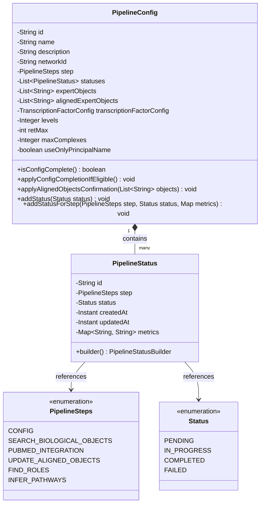

# Data Model: Use Cases Lightweight Orchestration and Parameter Encapsulation

**Feature**: `004-usecase-orchestration-encapsulation`
**Date**: 2026-11-19
**Spec**: [spec.md](./spec.md)

---

## 1. Domain Entities & Aggregates

### 1.1 `PipelineConfig` (Rich Domain Entity)
Existing domain aggregate in `com.biopatternsg.domain.models.PipelineConfig`. Enriched with domain methods for business invariant enforcement and step status transitions.

#### New Domain Methods on `PipelineConfig`:
- **`boolean isConfigComplete()`**:
  Evaluates whether all configuration fields are present and valid:
  - `name != null && !name.isBlank()`
  - `description != null && !description.isBlank()`
  - `levels != null && levels > 0`
  - `retMax > 0`
  - `maxComplexes != null && maxComplexes > 0`
- **`void applyConfigCompletionIfEligible()`**:
  If `isConfigComplete()` is true, transitions `CONFIG` step or appends status with `Status.COMPLETED`.
- **`void applyAlignedObjectsConfirmation(List<String> objects)`**:
  Sets `alignedExpertObjects`, sets `step = PipelineSteps.UPDATE_ALIGNED_OBJECTS`, generates the metric map (`totalAlignedObjects`, `alignedSymbols`, `statusMessage = "Manual alignment confirmed by expert"`), and registers status `COMPLETED`.

---

## 2. Application Context Models

### 2.1 `PipelineResumptionBatch` (Application Context Accumulator)
Encapsulates mutable state during batch resumption execution, preventing methods with more than 3 parameters.

- **Package**: `com.biopatternsg.application.models` or nested in `ResumePipelineUseCase`
- **Fields**:
  - `List<String> resumedPipelineIds`: Accumulated IDs of successfully resumed pipelines.
  - `List<String> failedPipelineIds`: Accumulated IDs of pipelines that failed resumption.
  - `Map<String, String> errors`: Mapping of `pipelineId` to error message.
- **Methods**:
  - `void recordSuccess(String pipelineId)`
  - `void recordFailure(String pipelineId, String reason)`
  - `PipelineResumeResponse toResponse(MicroService microService, int totalFound)`

---

## 3. Reporting Value Objects (Unchanged Contracts)

### 3.1 `ExperimentExecutionResponse`
Record returned by `GetPipelineExecutionUseCase` and constructed by `PipelineExecutionService`:
- `String experimentId`
- `String experimentName`
- `String status`
- `String totalExecutionTime`
- `String currentPhaseDuration`
- `List<PipelineStepExecutionResponse> steps`

### 3.2 `PipelineStepExecutionResponse`
Record representing an individual step in the timeline:
- `String id`
- `String name`
- `String status`
- `String startTime`
- `String duration`
- `String outputText`
- `String description`
- `String iconName`
- `Map<String, String> metrics`
